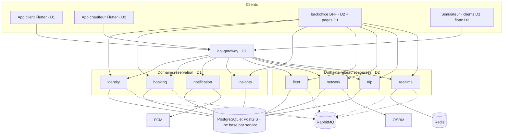
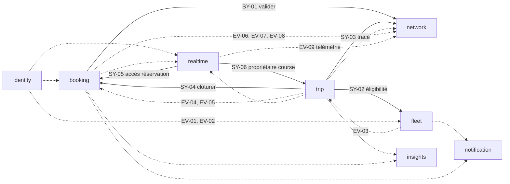
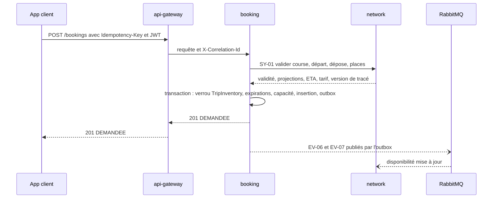
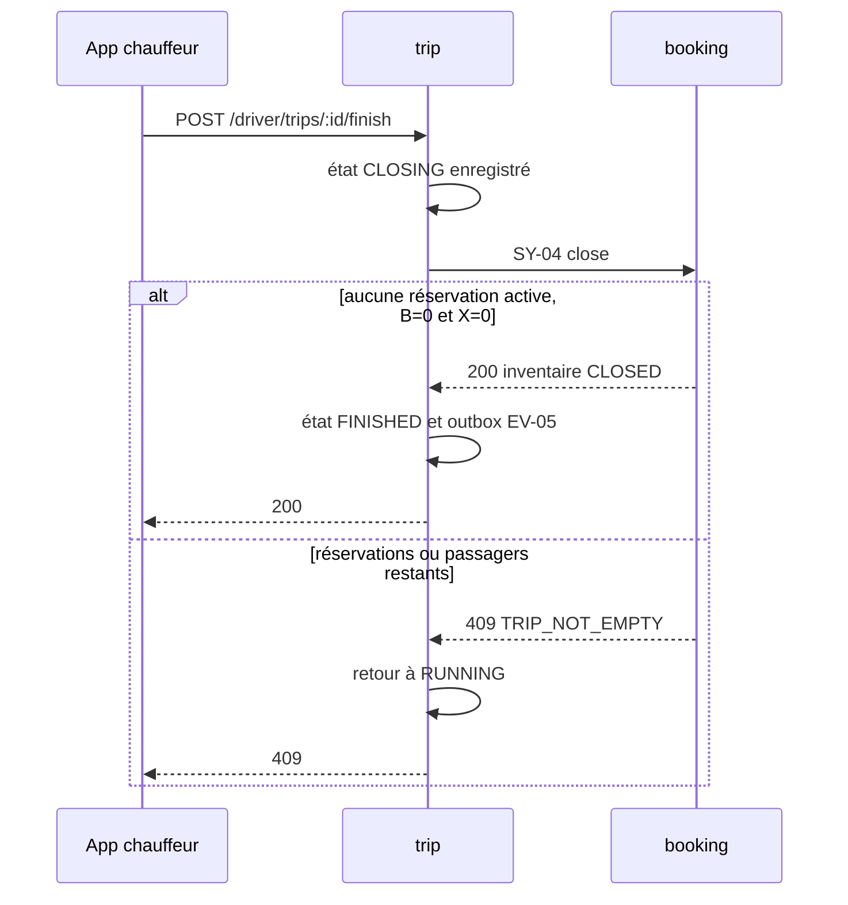

# Blasti — Planning microservices pour 2 développeurs : travail séparé, CDC respecté

**Projet :** PFA 5IIR, option Développement Digital et Systèmes d’Information, EMSI Rabat  
**Base :** [`PLANNING.md`](PLANNING.md) v2.0 — c’est lui qui porte le CDC (exigences E01–E25, décisions D01–D12, recettes R01–R26)  
**Version du plan :** 3.0 — 13 novembre 2026  
**Horizon :** 16 semaines à 37,5 h par personne (raison en section 13)  
**Équipe :** Développeur 1 (D1) et Développeur 2 (D2), rôles interchangeables  
**Statut :** proposition de travail. Aucun build, test ou mesure n’a été exécuté pour rédiger ce plan.

**Vocabulaire.** Dans ce document, **CDC** désigne uniquement le *cahier des charges* (`PLANNING.md` et le CDC détaillé à valider en S2). Les *contrats pilotés par le consommateur* (consumer-driven contracts) sont appelés « contrats consommateur » : ils servent à ce que D1 et D2 avancent sans se bloquer. Le plan respecte les deux.

## 1. Lecture rapide

- **10 déploiements** : 4 pour D1, 6 pour D2. Chaque service a un seul propriétaire, un dossier, une base, une CI. L’écart de nombre n’est pas un écart de charge : D1 porte `booking` (le service critique), l’app client, `platform/` et l’infra ; la passerelle et le back-office de D2 sont légers. Les heures sont égales (section 13).
- **Les places ont un seul écrivain** : `booking-service` (D1). Le stock `C/H/B/X` de `PLANNING.md` §9 n’existe nulle part ailleurs.
- **Contrat avant code.** Toute interaction entre D1 et D2 passe par un contrat versionné (REST, événement ou protocole WebSocket) et un test de contrat. Le partenaire est remplacé par un stub tant qu’il n’a pas livré.
- **Chemin chaud sans dépendance** : la recherche n’appelle aucun service ; la réservation en appelle un seul (`network-service`, 500 ms max, échec fermé).
- **Coût assumé** : les microservices ajoutent **+120 h** (960 h au lieu de 840 h). À 30 h planifiées par semaine et par personne, cela donne **16 semaines** au lieu de 14.
- **Aucune règle métier ne change.** États, stock, appariement, temps réel, sécurité : `PLANNING.md` §8–§11 et §13 restent la référence. Ce document dit *où* chaque règle s’exécute et *qui* la possède.

| Propriétaire | Services | Applications et outils |
|---|---|---|
| **D1** — réservation | `identity`, `booking`, `notification`, `insights` | `apps/client`, `packages/blasti_api_client`, `packages/blasti_ui`, `platform/`, `simulator/clients`, infra Compose et CI |
| **D2** — réseau et courses | `api-gateway`, `fleet`, `network`, `trip`, `realtime`, `backoffice` | `apps/driver`, `packages/blasti_realtime`, `packages/blasti_map`, `simulator/fleet`, outillage de contrats, OSRM et Redis |

## 2. Écarts avec `PLANNING.md` v2.0

| Sujet | `PLANNING.md` v2.0 | Ce plan | Raison |
|---|---|---|---|
| Architecture serveur | Monolithe Spring Boot (§1, §6.1) | 9 services Spring Boot + back-office BFF | Demande explicite : microservices |
| « Microservices » | Extension hors engagement (§2) | Dans le périmètre. **Kubernetes reste hors périmètre** | Compose suffit pour la soutenance |
| Compteurs de places | Dans l’entité `Trip` (§7.1) | `TripInventory` dans `booking-service` ; `Trip` (état, véhicule, route) dans `trip-service` | Un invariant, un propriétaire |
| Packaging mobile | Un projet, deux flavors (D01, §6.5) | Deux projets Flutter (`apps/client`, `apps/driver`) + 4 packages Dart communs | Supprime les conflits sur `lib/` et `android/`. Deux APK, code partagé : l’intention de D01 est conservée |
| Back-office | Thymeleaf dans le serveur (§6.1) | Service `backoffice` distinct (BFF), sans base | Pas de module partagé entre les deux développeurs |
| WebSocket | Transport D2, événements D1 dans un diffuseur commun (§12.2) | `realtime-service` (D2) consomme les événements de D1 sur le bus | Plus de code partagé |
| Répartition | Lots entremêlés, relecteur sur chaque ticket (§16, §22) | Propriété par service, relecture limitée aux contrats, à la sécurité et aux migrations | Travail séparé |
| Durée et charge | 14 semaines, 840 h | 16 semaines, 960 h | Section 13 |

**Inchangés :** §3 (analyse terrain), §5 (acteurs et écrans), §8 (états), §9 (stock et verrou), §10 (paramètres temps réel), §11 (appariement), §13 (ergonomie et sécurité), §14 (simulateur), §15 (prévision), §17.2 (R01–R26), §17.3, §20, §23–§25.  
**Complétés :** §4 (la colonne « responsable » est remplacée par la section 11 ci-dessous), §17.2 (R27–R31, section 16), §19 (risques, section 18).  
L’API publique de §12.1 est conservée telle quelle : les applications mobiles ne voient pas le découpage. La passerelle route par ressource (section 6.1).

## 3. Principes d’architecture et de séparation

| # | Principe | Conséquence concrète |
|---|---|---|
| P1 | **Une donnée, un propriétaire** | Aucun service ne lit ni n’écrit la base d’un autre. Les copies (réplicas) arrivent par événements et sont en lecture seule. |
| P2 | **Un invariant, un service** | `0 ≤ H + B + X ≤ C` est garanti uniquement par `booking-service`, sous verrou de la ligne `TripInventory`. |
| P3 | **Chemin chaud sans appel synchrone en cascade** | Recherche : 0 appel sortant. Création de réservation : 1 appel (SY-01), lecture seule, échec fermé. |
| P4 | **Graphe synchrone sans cycle** | Un état se propage par événement. Un appel synchrone sert une commande rare ou une validation. |
| P5 | **Contrat avant code** | Contrat proposé, accepté par le fournisseur, puis implémenté. Évolutions additives dans une version. |
| P6 | **Un service = un dossier, un build, une CI, une base, un propriétaire** | Aucun import de code d’un autre service. |
| P7 | **Pas de bibliothèque de domaine partagée** | Seul `platform/` (technique : sécurité, erreurs, corrélation, outbox) est commun. Les DTO sont dupliqués volontairement. |
| P8 | **La panne partielle est prévue** | Chaque appel a un délai, un comportement dégradé et une recette (section 9). |
| P9 | **Le CDC prime** | Un service ne réinterprète pas une règle de `PLANNING.md`. Un doute se règle dans le CDC, pas dans le code. |

## 4. Architecture

### 4.1 Topologie



Trait plein : appel synchrone. Pointillé : événements via RabbitMQ (détail section 4.2). Les liens vers PostgreSQL passent chacun par une base et un rôle distincts.

### 4.2 Dépendances entre services



Aucun cycle synchrone : `booking → network`, `trip → {fleet, network, booking}`, `realtime → {booking, trip}`. Le rattrapage à froid (SY-09, SY-10) rend `network` client de `trip` et `booking` **au démarrage seulement** ; il ne compte pas dans le chemin chaud (section 7.2).

## 5. Propriété des données

| Donnée | Propriétaire (écrit) | Copies autorisées (lecture seule, par événement) |
|---|---|---|
| `User`, `UserRole`, `RefreshToken`, `PasswordResetToken`, `ServiceClient` | `identity` | `booking` (liste des comptes suspendus), `fleet`, `realtime` |
| `DriverProfile`, `Vehicle`, `Permit`, `DriverVehicleAssignment`, pièces | `fleet` | éligibilité résumée dans `trip` (appel SY-02, pas de copie) |
| `City`, `Line`, `RoutePattern`, `Stop`, `RouteStop`, `RouteOverlap` | `network` | aucune ; `trip` interroge SY-03 à l’ouverture |
| `Trip`, `TripEvent` (état de la course) | `trip` | `ActiveTrip` dans `network`, `TripInventory` initial dans `booking`, propriétaire de course dans `realtime` |
| `TripInventory` (`C`, `H`, `B`, `X`, état) | `booking` | `TripAvailability` (`F` et état) dans `network` |
| `Booking`, `BookingEvent`, `IdempotencyRecord` | `booking` | faits agrégés dans `insights` |
| `Rating`, `Report` | `booking` | moyenne par chauffeur dans `network` (`DriverRating`) |
| `DeviceToken`, `Notification`, `DeliveryAttempt` | `notification` | aucune |
| `BookingFact`, `DemandSlot`, `DemandForecast`, `ModelRun` | `insights` | aucune |
| Position courante et présence | `realtime` (Redis, TTL) | dernière position en mémoire dans `network` (télémétrie) |
| `AuditLog` des actions d’administration | le service qui exécute l’action | le back-office agrège par appel |

Chaque service possède aussi `Outbox` (publication) et `ProcessedEvent` (consommation, déduplication) lorsqu’il utilise le bus.

**Contraintes SQL de `PLANNING.md` §7.2** : index partiels uniques « une course active par chauffeur et véhicule » dans la base `trip` ; `CHECK` sur `C`, `H`, `B`, `X` et la somme dans la base `booking` ; index GiST et `ST_DWithin` dans la base `network` (seule base qui exige PostGIS).

## 6. Fiches de service

Format : responsabilité, données, API publique (via la passerelle), API interne, événements, dépendances synchrones, exigences CDC.

### 6.1 `api-gateway` — D2

- **Responsabilité :** routage, validation du JWT (signature via JWKS, mise en cache), limitation de débit, identifiant de corrélation `X-Correlation-Id` créé ici, proxy WebSocket, refus de tout `/internal/**` et `/admin/**`. Sans état, sans base.
- **Routage (le plus spécifique d’abord) :**

| Motif de chemin | Service |
|---|---|
| `/auth/**`, `/me` | `identity` |
| `/me/devices`, `/me/notifications` | `notification` |
| `/me/bookings`, `/bookings/**`, `/reports` | `booking` |
| `/driver/trips/*/bookings`, `/driver/trips/*/external-occupancy` | `booking` |
| `/driver/trips/*/position`, `/ws` | `realtime` |
| `/driver/trips/**` | `trip` |
| `/driver/profile`, `/driver/vehicles/**`, `/driver/permits/**` | `fleet` |
| `/cities/**`, `/lines/**`, `/taxi-candidates` | `network` |
| `/driver/demand-forecast` | `insights` |

- **Limites proposées (à valider) :** 10 tentatives de connexion par minute et par IP ; 20 créations de réservation par minute et par compte ; 30 recherches par minute et par compte.
- **CDC :** E20 (périmètre), R20. **Hors périmètre :** logique métier, agrégation de réponses.

### 6.2 `identity` — D1

- **Responsabilité :** comptes, rôles, inscription client et chauffeur (jamais admin ni support), connexion, JWT d’accès RS256 de 10 minutes (valeur de départ), refresh révocable et haché avec rotation, réinitialisation par jeton à usage unique, suspension et réintégration, comptes de service (client credentials), limitation des tentatives.
- **Données :** `User`, `UserRole`, `RefreshToken`, `PasswordResetToken`, `ServiceClient`, `AuditLog`.
- **API publique :** `/auth/register`, `/auth/login`, `/auth/refresh`, `/auth/logout`, `/auth/password-reset`, `/me`.
- **API interne :** `POST /oauth/token` (jeton de service), `GET /.well-known/jwks.json`. **Admin :** `/admin/users`, `/admin/users/{id}/suspension`.
- **Publie :** EV-01 `identity.account.suspended.v1`, EV-02 `identity.account.reinstated.v1`. **Consomme :** rien. **Appels synchrones :** aucun.
- **CDC :** E20, E16 (suspension) ; R17, R20.

### 6.3 `booking` — D1 (service critique)

- **Responsabilité :** réservation et inventaire de places. Seul propriétaire de `H`, `B`, `X`, `F`. Machine à états `PLANNING.md` §8, verrou de course §9.2, idempotence, expiration, occupation externe, avis, signalements, historique client, vue chauffeur des réservations de sa course, clôture de l’inventaire, réconciliation `H/B/X` contre les réservations.
- **Données :** `TripInventory`, `Booking`, `BookingEvent`, `IdempotencyRecord`, `Rating`, `Report`, `BlockedUser` (réplica), `AuditLog`.
- **API publique :** `/bookings` (création), `/bookings/{id}` et ses actions (`accept`, `reject`, `approach`, `board`, `complete`, `cancel`, `rating`), `/me/bookings`, `/driver/trips/{id}/bookings`, `/driver/trips/{id}/external-occupancy`, `/reports`. **Admin :** `/admin/bookings`, `/admin/reports`.
- **API interne :** SY-04 clôture d’inventaire, SY-05 contrôle d’accès à une réservation, SY-10 snapshot (inventaires et moyennes).
- **Publie :** EV-06 `booking.booking.status-changed.v1`, EV-07 `booking.trip-inventory.changed.v1`, EV-08 `booking.driver-rating.changed.v1`.
- **Consomme :** EV-04 et EV-05 (cycle de la course), EV-01 et EV-02 (comptes suspendus).
- **Appel synchrone :** SY-01 vers `network`, **avant** le verrou.
- **CDC :** E03, E04, E05, E06, E08, E11 (données), E12, E16 ; R03–R07, R10, R12, R13, R17.

### 6.4 `notification` — D1

- **Responsabilité :** jetons FCM par installation (rotation, désactivation des jetons invalides), notifications persistées, envoi avec reprise et délai progressif, lecture et marquage.
- **Données :** `DeviceToken`, `Notification`, `DeliveryAttempt`. **API publique :** `/me/devices`, `/me/notifications`.
- **Consomme :** EV-06 (client et chauffeur), EV-03 (chauffeur non éligible), EV-05 (course interrompue). **Publie :** rien. **Appels synchrones :** aucun.
- FCM est derrière une interface ; les tests et le simulateur utilisent un double. Un push n’est pas un accusé métier (`PLANNING.md` §10.4).
- **CDC :** E09 ; R11, R25.

### 6.5 `insights` — D1

- **Responsabilité :** faits de demande, statistiques globales (E17), grille complète ligne/créneau avec zéros, baseline et modèle de prévision (E22), versions de modèle, métriques MAE/RMSE. `PLANNING.md` §15 reste la démarche.
- **Données :** `BookingFact`, `DemandSlot`, `DemandForecast`, `ModelRun`.
- **API :** `/driver/demand-forecast`. **Admin :** `/admin/stats/**`, `/admin/forecast/**`.
- **Consomme :** EV-06, EV-04, EV-05. **Publie :** rien. **Appels synchrones :** aucun.
- Les statistiques propres au chauffeur (courses, durée) viennent de `trip` (D2).
- **CDC :** E17, E22 ; R18, R22.

### 6.6 `fleet` — D2

- **Responsabilité :** profil chauffeur, véhicules (capacité 1–6, immatriculation unique), agréments (titulaire distinct du chauffeur, D02), affectations, validation administrative, pièces justificatives hors dossier public, **éligibilité** d’un chauffeur à ouvrir une course.
- **Données :** `DriverProfile`, `Vehicle`, `Permit`, `DriverVehicleAssignment`, métadonnées de pièces (+ volume privé), `AuditLog`.
- **API publique :** `/driver/profile`, `/driver/vehicles`, `/driver/permits` (avec envoi de fichier). **Admin :** `/admin/drivers`, `/admin/vehicles`, `/admin/permits` (valider, refuser, suspendre).
- **API interne :** SY-02 éligibilité. **Publie :** EV-03 `fleet.driver.eligibility-changed.v1`. **Consomme :** EV-01, EV-02. **Appels synchrones :** aucun.
- Fleet est la seule autorité sur l’éligibilité : une suspension d’identité devient une inéligibilité ici, puis `trip` réagit à EV-03.
- **CDC :** E15 ; R16.

### 6.7 `network` — D2

Deux modules dans un déploiement (ADR-M05) : le **référentiel** et l’**appariement**.

- **Référentiel :** villes, lignes, tracés orientés versionnés `LineString(4326)`, arrêts, tronçons communs `RouteOverlap`. Un nouveau tracé ne s’applique qu’aux futures courses (`PLANNING.md` §8.2).
- **Appariement :** pipeline `PLANNING.md` §11.2 (corridor `ST_DWithin`, ordre `ST_LineLocatePoint`, OSRM, score §11.3, trajets croisés §11.4). Il s’appuie sur des réplicas locaux :

| Réplica | Source | Usage |
|---|---|---|
| `ActiveTrip` | EV-04, EV-05 | Courses à considérer, route et version |
| `TripAvailability` | EV-07 | `F` indicatif, état de l’inventaire |
| `DriverRating` | EV-08 | Pénalité de note |
| Dernière position (mémoire) | EV-09 | Ordre sur le tracé, fraîcheur (30 s) |

- **Données :** `City`, `Line`, `RoutePattern`, `Stop`, `RouteStop`, `RouteOverlap`, `AuditLog` + réplicas ci-dessus.
- **API publique :** `/cities`, `/lines`, `/lines/{id}`, `/taxi-candidates`. **Admin :** `/admin/cities`, `/admin/lines`, `/admin/route-patterns`, `/admin/stops`.
- **API interne :** SY-01 validation d’une demande, SY-03 lecture d’un tracé.
- **Rattrapage à froid :** SY-09 (`trip`), SY-10 (`booking`). **Publie :** rien. **Appel synchrone chaud :** aucun.
- **Seuil de scission :** séparer l’appariement du référentiel si le calcul de recherche gêne l’administration ou demande une mise à l’échelle distincte.
- **CDC :** E01 (données), E02, E14, E18, E19 ; R01, R02, R15, R19.

### 6.8 `trip` — D2

- **Responsabilité :** cycle de vie de la course. États : `OPEN` (en station), `RUNNING` (en route), `CLOSING`, `FINISHED`, `INTERRUPTED` (D10 distingue station et route). Vérification d’éligibilité et de tracé à l’ouverture, saga de clôture, interruption, historique, résumé et statistiques du chauffeur.
- **Données :** `Trip`, `TripEvent`. **API publique :** `/driver/trips` (ouverture, historique), `/driver/trips/{id}`, `/driver/trips/{id}/start`, `/driver/trips/{id}/finish`. **Admin :** `/admin/trips`.
- **API interne :** SY-06 propriétaire d’une course, SY-09 snapshot des courses actives.
- **Publie :** EV-04 `trip.trip.opened.v1`, EV-05 `trip.trip.status-changed.v1`. **Consomme :** EV-03.
- **Appels synchrones :** SY-02 vers `fleet`, SY-03 vers `network`, SY-04 vers `booking`.
- **CDC :** E10, E17 (chauffeur) ; R12, R16.

### 6.9 `realtime` — D2

- **Responsabilité :** WebSocket JSON natif (`PLANNING.md` §12.2), repli HTTPS de position, validation GPS (bornes, séquence, plausibilité, §10.1), fraîcheur (30 s), diffusion des positions et des événements aux seules parties autorisées, fermeture des connexions à l’expiration du jeton ou à la suspension.
- **Données :** Redis uniquement : `pos:{tripId}` avec TTL 60 s, sessions. Pas de PostgreSQL.
- **API publique :** `/ws`, `POST /driver/trips/{id}/position`. **Admin :** `/admin/positions` (carte du back-office, interrogation toutes les 10 s).
- **Publie :** EV-09 télémétrie sur un échange transitoire, au plus un échantillon par course toutes les 5 s.
- **Consomme :** EV-05, EV-06, EV-07, EV-01. **Appels synchrones :** SY-05 (abonnement client), SY-06 (propriétaire de course, absent du cache).
- Autorisation : un client s’abonne à une réservation → SY-05 → il rejoint le groupe de sa course. Quand la réservation sort de `ACCEPTEE`/`EN_APPROCHE` (EV-06), il en sort. Un redémarrage vide les groupes : les clients se reconnectent et relisent leur snapshot REST.
- **CDC :** E07 ; R08, R09, R20 (WebSocket), R26.

### 6.10 `backoffice` — D2 (coque) et D1 (pages)

- **Responsabilité :** BFF Spring MVC/Thymeleaf et Leaflet. Connexion via `identity`, session serveur qui garde les jetons, CSRF, cookies Secure/HttpOnly/SameSite. Appelle directement `/admin/**` sur le réseau interne avec le JWT de l’utilisateur. Sans base. Les pages se déclarent dans la navigation par un bean `NavEntry` : chaque développeur ajoute ses pages sans toucher aux fichiers de l’autre.
- **Pages D2 :** dossiers chauffeurs, véhicules et agréments ; villes, lignes, arrêts ; courses actives et carte.
- **Pages D1 :** comptes, réservations, signalements et litiges, statistiques et prévisions.
- **Journal d’administration :** agrégation en lecture des `AuditLog` des services (D1 pour sa part, D2 pour la sienne).
- **CDC :** E14, E15, E16, E17, E22 (affichage) ; R15–R18.

## 7. Contrats

### 7.1 Catalogue des événements (RabbitMQ, échange `blasti.events`, clé `<service>.<entité>.<événement>.v1`)

| ID | Événement | Producteur | Consommateurs | Contenu minimal |
|---|---|---|---|---|
| EV-01 | `identity.account.suspended.v1` | identity | fleet, booking, realtime | `userId`, motif, date |
| EV-02 | `identity.account.reinstated.v1` | identity | fleet, booking | `userId` |
| EV-03 | `fleet.driver.eligibility-changed.v1` | fleet | trip, notification | `driverId`, `eligible`, `reasonCode` |
| EV-04 | `trip.trip.opened.v1` | trip | booking, network, insights, realtime | `tripId`, `driverId`, `vehicleId`, `capacity`, `initialExternalOccupancy`, `lineId`, `routePatternId`, `routePatternVersion`, `status` |
| EV-05 | `trip.trip.status-changed.v1` | trip | booking, network, insights, realtime, notification | `tripId`, `status`, `reasonCode` |
| EV-06 | `booking.booking.status-changed.v1` | booking | realtime, notification, insights | `bookingId`, `tripId`, `clientId`, `driverId`, `lineId`, `routePatternId`, `seats`, `fareMad`, `previousStatus`, `status`, `reasonCode` |
| EV-07 | `booking.trip-inventory.changed.v1` | booking | network, realtime | `tripId`, `capacity`, `held`, `boarded`, `external`, `free`, `status` |
| EV-08 | `booking.driver-rating.changed.v1` | booking | network | `driverId`, `average`, `count` |
| EV-09 | `telemetry.position.sampled.v1` (échange transitoire) | realtime | network | `tripId`, `lon`, `lat`, `seq`, `receivedAt` |

La création d’une réservation est un EV-06 avec `previousStatus` vide et `status = DEMANDEE` : pas d’événement « demandée » séparé.

**Enveloppe commune** (reprend `PLANNING.md` §10.3) :

```json
{
  "eventId": "…", "type": "booking.booking.status-changed", "schemaVersion": 1,
  "occurredAt": "2026-12-01T08:30:12Z", "correlationId": "…",
  "entityId": "<bookingId>", "entityVersion": 3,
  "payload": { "bookingId": "…", "tripId": "…", "clientId": "…", "driverId": "…",
               "lineId": "…", "routePatternId": "…", "seats": 2, "fareMad": "10.00",
               "previousStatus": "DEMANDEE", "status": "ACCEPTEE", "reasonCode": null }
}
```

**Règles de publication et de consommation**

1. **Outbox transactionnelle :** l’événement est écrit dans la même transaction que l’agrégat. Un relais le publie toutes les 500 ms (`SELECT … FOR UPDATE SKIP LOCKED`, confirmation du broker). Jamais d’appel au broker à l’intérieur d’une transaction métier.
2. **Livraison au moins une fois, consommateurs idempotents :** table `ProcessedEvent` (clé `eventId`) ; un événement dont `entityVersion` est inférieur ou égal à la version connue est ignoré.
3. **Une file durable par couple consommateur/producteur**, nommée `<consommateur>.<événement>`. Trois reprises avec délai progressif, puis file morte `….dlq` surveillée et rejouable par script.
4. **Charge utile minimale** mais suffisante pour qu’un consommateur n’ait pas à rappeler le producteur. Pas de nom, de téléphone ni de position précise de client dans un événement.
5. **Télémétrie :** échange distinct, files non durables avec TTL de 30 s. Une perte est tolérée ; les événements de domaine ne passent jamais par là.
6. **Redis Pub/Sub n’est pas le bus de domaine** : pas de rattrapage des messages manqués (`PLANNING.md` §25, T9).

### 7.2 Catalogue des appels synchrones internes (`/internal/v1`, jeton de service obligatoire)

| ID | Appelant → appelé | Opération | Délai | Si l’appelé est indisponible |
|---|---|---|---|---|
| SY-01 | booking → network | `POST /internal/v1/matching/validate` : course, départ, dépose, places → validité, projections, ETA, tarif de référence par place, version de tracé, âge de position | 500 ms, lecture seule, 1 reprise | `503 MATCHING_UNAVAILABLE`, aucune réservation créée |
| SY-02 | trip → fleet | `GET /internal/v1/drivers/{userId}/eligibility?vehicleId=` | 1 s | Ouverture refusée (`503`) |
| SY-03 | trip → network | `GET /internal/v1/route-patterns/{id}` : existence, version active | 1 s | Ouverture refusée (`503`) |
| SY-04 | trip → booking | `POST /internal/v1/trips/{id}/close` : idempotent, `409 TRIP_NOT_EMPTY` si `H`, `B` ou `X` non nuls | 2 s | La course reste `CLOSING`, relance automatique |
| SY-05 | realtime → booking | `GET /internal/v1/bookings/{id}/access?userId=` | 500 ms | Abonnement refusé, le client relit le snapshot REST |
| SY-06 | realtime → trip | `GET /internal/v1/trips/{id}/owner` (mis en cache 60 s) | 500 ms | Position rejetée, le chauffeur réessaie |
| SY-07 | tous → identity | `POST /oauth/token` et JWKS (mis en cache) | 1 s | Jeton de service et JWKS en cache jusqu’à expiration |
| SY-08 | backoffice → services | `/admin/**` avec le JWT de l’utilisateur | 3 s | Page en erreur, aucun impact utilisateur final |
| SY-09 | network → trip | snapshot paginé des courses actives (démarrage à vide) | 5 s | Appariement vivant non prêt (readiness faux) |
| SY-10 | network → booking | snapshot paginé des inventaires et moyennes | 5 s | Idem |

**Latence de la création de réservation :** SY-01 visé à 300 ms au p95, transaction à 200 ms au p95 hors contention, pour tenir l’objectif de 1 s de `PLANNING.md` §17.3. Valeurs à mesurer en S14.

### 7.3 Contrats publics des applications mobiles

| ID | Fournisseur | Consommateurs | Contenu |
|---|---|---|---|
| PU-identity | identity | client, chauffeur | `/auth/**`, `/me` |
| PU-network | network | client, chauffeur | `/cities`, `/lines`, `/taxi-candidates` |
| PU-booking | booking | client, chauffeur | `/bookings/**`, `/me/bookings`, `/reports`, `/driver/trips/{id}/bookings`, `/driver/trips/{id}/external-occupancy` |
| PU-trip | trip | chauffeur | `/driver/trips/**` |
| PU-fleet | fleet | chauffeur | profil, véhicules, agréments |
| PU-notification | notification | client, chauffeur | `/me/devices`, `/me/notifications` |
| PU-insights | insights | chauffeur | `/driver/demand-forecast` |
| PU-ws | realtime | client, chauffeur | messages de `PLANNING.md` §12.2 |

### 7.4 Comment les contrats sont testés (contrats consommateur)

| Type | Source de vérité | Test côté consommateur | Contrôle côté fournisseur |
|---|---|---|---|
| REST interne (SY-xx) | OpenAPI du fournisseur, `contracts/openapi/<service>.yaml` | Pact JVM : le consommateur écrit ce qu’il attend | Vérification du fichier Pact dans la CI du fournisseur + comparaison OpenAPI contre `main` (`openapi-diff`) |
| Événements (EV-xx) | Schéma JSON du producteur, `contracts/events/*.schema.json` | Pact de messages : le consommateur décrit ce qu’il lit | Le producteur génère un message réel et le valide contre le schéma et le Pact |
| REST mobile (PU-xx) | OpenAPI du fournisseur | Exemples JSON versionnés dans `contracts/examples/<service>/`, utilisés par les tests Flutter | Le test d’intégration du fournisseur valide chaque exemple contre son OpenAPI et sa réponse réelle |
| WebSocket (PU-ws) | Fichier de messages JSON de `realtime` | Tests de `blasti_realtime` contre le fichier | Test de bout en bout de `realtime` rejouant le fichier |

**Procédure sans courtier de contrats** (deux dossiers) :

1. Le consommateur ajoute son Pact dans `contracts/pacts/proposed/<consommateur>-<fournisseur>/` par une PR ; le fournisseur en est notifié par CODEOWNERS.
2. Le fournisseur répond sous **2 jours ouvrés** : il implémente et déplace le fichier vers `accepted/`, ou il discute dans la PR. La CI du fournisseur vérifie `accepted/` (bloquant) et `proposed/` (rapport non bloquant).
3. Tant que le fournisseur n’a pas livré, le consommateur travaille avec le stub généré depuis le Pact. Il n’attend pas.
4. Une rupture de compatibilité passe par une nouvelle version (`v2`) publiée en parallèle ; l’ancienne est retirée une fois les consommateurs migrés, plus un sprint de délai.

**Règles d’évolution (contrat v1) :** ajouts de champs optionnels uniquement ; lecteur tolérant (champs inconnus ignorés, valeurs d’énumération inconnues traitées par une branche par défaut) ; aucun champ retiré ni renommé ; un contrat n’est jamais modifié sans PR visible du partenaire.

**Erreurs :** format commun `{ code, message, correlationId, retryable }`, avec les codes de `PLANNING.md` §12.1 plus `MATCHING_UNAVAILABLE`, `TRIP_NOT_AVAILABLE`, `TRIP_NOT_EMPTY`, `TRACKING_STALE`, `INVENTORY_CLOSED`.

## 8. Flux transverses critiques

### 8.1 Créer une réservation



Dans la transaction, `booking` contrôle : compte non suspendu (réplica), inventaire `OPEN` ou `RUNNING`, **version de tracé identique à celle renvoyée par SY-01**, une réservation active par client (règle anti-abus proposée en `PLANNING.md` §13.2), puis la capacité. Si SY-01 échoue ou dépasse 500 ms, la réservation est refusée avant tout verrou.

### 8.2 Ouvrir et clôturer une course

1. **Ouverture :** l’app chauffeur appelle `trip`. `trip` interroge SY-02 (éligibilité, véhicule, agrément valide) et SY-03 (tracé actif), crée la course `OPEN`, puis publie EV-04 par l’outbox. `booking` crée alors le `TripInventory` (`C`, `X = occupation initiale`, `H = B = 0`) et publie EV-07 ; `network` rend la course visible dès qu’il reçoit cette disponibilité.
2. **Départ :** `start` fait passer la course à `RUNNING` (EV-05).
3. **Clôture, saga orchestrée par `trip` :**



Si `trip` s’arrête entre `CLOSING` et la réponse, un job relance SY-04 (idempotent) jusqu’au résultat. Une course ne reste jamais `CLOSING` sans reprise.

### 8.3 Interruption et suspension

- **Chauffeur suspendu ou agrément invalide :** `fleet` publie EV-03 (`eligible=false`) → `trip` passe les courses actives en `INTERRUPTED` (EV-05) → `booking` annule les réservations avant montée avec motif et laisse `A_BORD` occupé jusqu’à descente confirmée (`PLANNING.md` §8.2) ; `notification` informe ; `realtime` arrête le suivi.
- **Compte suspendu :** `identity` publie EV-01 → `booking` bloque toute nouvelle commande immédiatement, `realtime` ferme les connexions, `fleet` recalcule l’éligibilité. Le JWT déjà émis reste valide au plus 10 minutes ; les services qui reçoivent EV-01 refusent sans attendre l’expiration (D13).

### 8.4 Position et suivi

Le chauffeur envoie sa position à `realtime` (WebSocket ou HTTPS). `realtime` valide, écrit Redis, diffuse aux clients abonnés autorisés et publie un échantillon EV-09 au plus toutes les 5 s. `network` garde la dernière position en mémoire ; sans nouvel échantillon pendant 30 s, la course disparaît des résultats. Les transitions de réservation viennent de EV-06 : le WebSocket diffuse, il ne décide jamais (`PLANNING.md` §12.2).

### 8.5 Note du chauffeur

`booking` enregistre l’avis (un avis par réservation terminée), recalcule la moyenne et publie EV-08 ; `network` l’utilise dans le score (10 %). Valeur neutre documentée si aucun avis.

## 9. Résilience : comportement par panne

Sauf mention contraire, RabbitMQ est disponible. Chaque ligne est vérifiée par R28.

| Service ou ressource en panne | Effet attendu | Mécanisme |
|---|---|---|
| `identity` | Plus de connexion ni de refresh. Les JWT émis restent valides jusqu’à leur expiration (10 min) | JWKS et jeton de service en cache |
| `api-gateway` | Applications mobiles sans accès : point unique assumé pour le PFA | Une instance, redémarrage rapide, healthcheck |
| `booking` | Plus de création ni de transition. Recherche indicative disponible. Clôture de course refusée | Erreurs `503` explicites, `CLOSING` repris à la relance |
| `network` | Recherche et création de réservation refusées (`MATCHING_UNAVAILABLE`). Réservations existantes inchangées. Ouverture de course refusée | Échec fermé, aucun verrou pris |
| `fleet` | Ouverture de course refusée. Courses en cours inchangées | SY-02 échoue fermé |
| `trip` | Ouverture, démarrage, clôture indisponibles. Réservations, suivi et recherche continuent | Réplicas déjà reçus |
| `realtime` | Pas de suivi temps réel. Les apps passent au repli REST toutes les 10 s et signalent la dégradation. Les positions vieillissent, les courses sortent de la recherche après 30 s | Snapshot REST, fraîcheur côté `network` |
| `notification` | Plus de push. Les événements attendent dans la file | File durable, reprise au retour, REST et WebSocket restent la référence |
| `insights` | Statistiques et prévisions indisponibles. Aucun effet sur les parcours | Découplé par le bus |
| RabbitMQ | Les commandes réussissent, les événements s’accumulent dans l’outbox. Les réplicas se figent. La création re-contrôle l’inventaire en base | Outbox, alerte sur le retard de publication, rejeu à la reprise |
| PostgreSQL d’un service | Ce service est hors service, readiness faux. Les autres continuent | Une base par service |
| Redis | Suivi indisponible, appariement vivant suspendu après 30 s | Aucune donnée métier dans Redis |
| OSRM | ETA approximée (vitesse moyenne) et signalée `approx` ; accessibilité réelle non vérifiée (D14, à valider) | Délai 300 ms, repli documenté |

## 10. Sécurité entre services

| Sujet | Mesure | Recette |
|---|---|---|
| Authentification | JWT RS256, durée 10 min, claims `sub`, `roles`, `typ` (`user` ou `service`), `exp`, `jti` ; clé privée dans `identity` seul, clé publique via JWKS | R20 |
| Défense en profondeur | La passerelle valide le JWT **et** chaque service le revalide, puis contrôle rôle et propriété de la ressource | R20 |
| Appels internes | `typ=service`, portée par appelant, jeton obtenu en client credentials ; jeton utilisateur refusé sur `/internal/**` | R31 |
| Exposition | `/internal/**` et `/admin/**` jamais routés par la passerelle. Réseaux Docker `edge` (proxy, passerelle, back-office) et `internal` (le reste) | R31 |
| Bases | Un rôle par base, aucun droit croisé, bases non exposées | R31 |
| Back-office | Session serveur, CSRF, cookies Secure/HttpOnly/SameSite, rôles admin et support | R20 |
| Secrets | Variables d’environnement ; fichier `.env.example` seul versionné | R24 |
| Journaux | Identifiants métier et `correlationId` ; ni mot de passe, ni JWT, ni position détaillée | R20 |
| Suspension | EV-01 coupe immédiatement ; l’expiration du JWT est le plafond (D13) | R17, R31 |

## 11. Traçabilité CDC → services

**Lecture :** « Recette » désigne le **responsable de la preuve** puis son **contre-vérificateur**. Une recette qui traverse deux propriétaires est jouée sur l’environnement `full` et signée par les deux. Les jalons sont ceux de la section 14.

| ID | Exigence | Service (propriétaire) | Interface (propriétaire) | Contrats | Recette | Jalon |
|---|---|---|---|---|---|---|
| E01 | Ville, position, départ/destination | network (D2) | app client (D1) | PU-network | R01 D1 / D2 | S8 |
| E02 | Trouver les taxis sur le trajet | network (D2) | app client (D1) | PU-network, EV-04, EV-05, EV-07, EV-09 | R02 D2 / D1 | S8 puis S14 |
| E03 | Réserver 1–6 places | booking (D1) | app client (D1) | PU-booking, SY-01 | R03, R04 D1 / D2 | S8 |
| E04 | Accepter ou refuser | booking (D1) | app chauffeur (D2) | PU-booking | R05 D1 / D2 | S8 |
| E05 | Cycle de vie complet et sorties | booking (D1) | deux apps | PU-booking, EV-06 | R06, R07 D1 / D2 | S8 |
| E06 | Cohérence sous concurrence | booking (D1) | — | — | R04, R07 D1 / D2 | S8 |
| E07 | Suivi jusqu’à la prise en charge | realtime (D2) | app client (D1) | PU-ws, SY-05, EV-06 | R08, R09, R26 D2 / D1 | S11 |
| E08 | Espèces, historique, avis | booking (D1) | app client (D1) | PU-booking, EV-08 | R10 D1 / D2 | S11 |
| E09 | Notifications push | notification (D1) | deux apps | PU-notification, EV-03, EV-05, EV-06 | R11, R25 D1 / D2 | S11 |
| E10 | Déclarer trajet et places | trip, fleet (D2) ; inventaire booking (D1) | app chauffeur (D2) | PU-trip, SY-02, SY-03, EV-04 | R12 D2 / D1 | S8 |
| E11 | Clients sur la route | booking (D1) | app chauffeur (D2) | PU-booking | R13 D2 / D1 | S11 |
| E12 | Montées, déposes, places libérées | booking (D1) | app chauffeur (D2) | PU-booking, EV-07 | R06, R12 D1 / D2 | S11 |
| E13 | Navigation, gros boutons, alertes | — | app chauffeur (D2) | — | R14 D2 / D1 | S11 |
| E14 | Villes et lignes | network (D2) | backoffice (D2) | PU-network, SY-08 | R15 D2 / D1 | S11 |
| E15 | Chauffeurs, véhicules, agréments | fleet (D2) | backoffice (D2) | PU-fleet, EV-03 | R16 D2 / D1 | S11 |
| E16 | Support, modération, litiges | booking, identity (D1) | backoffice (D1) | SY-08, EV-01, EV-02 | R17 D1 / D2 | S11 |
| E17 | Statistiques | insights (D1) ; trip (D2) pour le chauffeur | backoffice (D1) ; app chauffeur (D2) | SY-08, PU-trip | R18 D1 / D2 | S12 |
| E18 | Appariement et classement | network (D2) | app client (D1) | PU-network, EV-08 | R02, R19 D2 / D1 | S14 |
| E19 | Trajets croisés | network (D2) | — | PU-network | R19 D2 / D1 | S14 |
| E20 | REST, WebSocket, rôles JWT | identity (D1), api-gateway (D2), chaque service | — | SY-07, PU-identity, PU-ws | R20, R31 D1 / D2 | S14 |
| E21 | PostgreSQL/PostGIS, Redis, OSM/OSRM | une base par service ; D1 PostgreSQL et RabbitMQ, D2 Redis et OSRM | — | — | R02, R08, R21 | S8 |
| E22 | IA complémentaire | insights (D1) | backoffice (D1), app chauffeur (D2) | PU-insights, SY-08 | R22 D1 / D2 | S14 |
| E23 | Simulateur et charge | simulator/clients (D1), simulator/fleet (D2) | — | format de scénario | R04, R23 D1 / D2 | S8 puis S14 |
| E24 | Terrain, CDC, UML, Git, rapport, démo | D1 50 % / D2 50 % | — | — | R24 | S2 à S16 |
| E25 | Docker et CI/CD | infra et CI (D1), builds mobiles et OSRM (D2) | — | — | R21 | S3 à S16 |

**Adaptation de R25 :** « installer les deux flavors » devient « installer les deux APK release sur un même téléphone » ; le contrôle (identifiants, configurations FCM, aucune confusion de compte) est inchangé.

### 11.1 Décisions du registre affectées

| Décision | Effet du découpage |
|---|---|
| D01 | Deux APK Flutter dans deux projets avec packages communs (ADR-M08) |
| D02 | L’entité agrément vit dans `fleet` |
| D03, D07 | Blocage dès `DEMANDEE` et stock global conservateur : implémentés dans `booking` seul |
| D08 | Occupation externe `X` : commande de `booking`, écran de l’app chauffeur |
| D09 | Course interrompue : EV-03 puis EV-05 puis annulation par `booking` (section 8.3) |
| D10 | Attente en station et en route : états `OPEN` et `RUNNING` de `trip` |
| D11 | Politique de conservation écrite **par service** pour ses données |
| D12 | Objectifs de `PLANNING.md` §17.3 inchangés ; le budget de latence de SY-01 est ajouté |

**Décisions nouvelles à valider en S2**

| ID | Question | Proposition de départ |
|---|---|---|
| D13 | Durée de vie du JWT d’accès et latence de propagation d’une suspension | 10 min, coupure immédiate par EV-01 |
| D14 | Comportement si OSRM est indisponible | ETA approximée et signalée, validité fondée sur la géométrie de la ligne |
| D15 | Plafond de la latence événementielle acceptable pour les réplicas | 5 s au p95, mesuré en S14 |

### 11.2 Recettes supplémentaires pour l’architecture

R01–R26 de `PLANNING.md` §17.2 restent inchangées. Les recettes suivantes prouvent le découpage ; elles ne remplacent aucune exigence E.

| Test | Action | Résultat attendu | Responsable / contre-vérificateur |
|---|---|---|---|
| R27 | CI complète ; changement cassant volontaire d’un OpenAPI et d’un schéma d’événement ; démarrage d’un service seul avec les stubs du partenaire | Tous les Pact `accepted` vérifiés ; rupture refusée par la CI ; service autonome | D2 (outillage) / D1 |
| R28 | Arrêter tour à tour `network`, `notification`, `realtime`, `insights`, `fleet`, `trip`, puis RabbitMQ pendant un scénario SIM01 | Comportement de la section 9 ; aucune surréservation ; aucun événement perdu après reprise | D1 et D2, chacun pour ses services |
| R29 | Rejouer, dupliquer et désordonner EV-04, EV-05, EV-06, EV-07 | Les réplicas convergent ; aucune double libération | D1 / D2 |
| R30 | Arrêter RabbitMQ 2 min pendant 200 commandes | Toutes les commandes sont durables ; événements livrés après reprise ; ordre par entité conservé | D1 / D2 |
| R31 | Appeler `/internal/**` sans jeton, avec jeton utilisateur, via la passerelle ; connexion croisée aux bases ; jeton de service expiré ; suspension | Tous refusés ; suspension propagée | D2 / D1 |

## 12. Organisation du travail séparé

### 12.1 Dépôt unique, propriété stricte

```text
blasti/
├─ services/
│  ├─ api-gateway/   D2        ├─ identity/      D1
│  ├─ fleet/         D2        ├─ booking/       D1
│  ├─ network/       D2        ├─ notification/  D1
│  ├─ trip/          D2        ├─ insights/      D1
│  ├─ realtime/      D2
│  └─ backoffice/    D2 (pages D1 dans bo/d1 et templates/d1)
├─ apps/
│  ├─ client/        D1
│  └─ driver/        D2
├─ packages/                       (Dart, techniques)
│  ├─ blasti_api_client/  D1       ├─ blasti_realtime/  D2
│  └─ blasti_ui/          D1       └─ blasti_map/       D2
├─ platform/         D1            (starter JVM : sécurité, erreurs, corrélation, outbox et inbox)
├─ contracts/
│  ├─ openapi/       fournisseur   ├─ events/    producteur
│  ├─ examples/      fournisseur   ├─ ws/        D2
│  ├─ pacts/proposed/  consommateur
│  ├─ pacts/accepted/  fournisseur
│  └─ tooling/       D2
├─ simulator/clients D1            simulator/fleet  D2
├─ infra/            compose, CI : D1 ; osrm, redis : D2
└─ docs/
```

`CODEOWNERS` suit ce tableau. Règle : **une PR touche un seul service** ; seules les PR de contrat ou de `platform/` en touchent plusieurs, et elles demandent l’avis du partenaire.

Chaque service est un projet Maven autonome (aucun module partagé autre que `platform/`), avec `Dockerfile`, migrations Flyway propres, `openapi.yaml` généré et contrôlé, `README` et `.env.example`. Un gabarit de service est livré en S3.

### 12.2 Règles quotidiennes

1. **Branches courtes** : `d1/<service>/<ticket>`, fusion en moins d’un jour ouvré, intégration continue sur `main`.
2. **CI filtrée par chemin** : la CI d’un service ne démarre que si ses fichiers ou ses contrats changent. Le travail en cours de l’un ne casse pas l’autre.
3. **Profils de développement** : `docker compose --profile infra --profile d1 --profile stubs-d2 up` pour D1 ; `--profile d2 --profile stubs-d1` pour D2 ; `--profile full` pour l’intégration. Les stubs viennent des Pact (outil unique, WireMock ou Pact stub server, choisi au spike S3).
4. **Vendredi d’intégration** : `full` est lancé et un smoke test (connexion, ouverture de course, réservation, suivi) est exécuté ; l’échec est traité le lundi avant tout nouveau ticket.
5. **Relecture limitée et ciblée** : le partenaire relit les **contrats**, la **sécurité** et les **migrations destructives**. Le reste est relu par l’auteur selon la définition de terminé. Cette relecture est comptée dans les 6 h hebdomadaires de vérification.
6. **Blocage** : si une livraison du partenaire manque 24 h après son échéance, passer au stub, noter l’écart dans `docs/integration-log.md` et poursuivre. Ne pas attendre.
7. **Synchronisation de 15 min par jour ouvré** ; point hebdomadaire de 1 h le vendredi, intégré au budget.

### 12.3 Équité 50/50 avec des services séparés

La propriété par service rend le rééquilibrage simple : on transfère un **service entier**, pas des fragments. Candidats de transfert, par charge estimée :

| Service ou lot | De | Vers | Charge |
|---|---|---|---|
| `notification` | D1 | D2 | 22 h |
| `fleet` | D2 | D1 | 28 h |
| Pages D1 du back-office | D1 | D2 | 20 h |

Chaque vendredi, comparer le réalisé et le reste à faire. Au-delà de 10 % d’écart sur la charge totale, transférer un des lots ci-dessus. `booking` et `realtime` ne se transfèrent pas : ils portent les deux risques techniques principaux (concurrence et suivi écran éteint). Un transfert est compté dans les heures du receveur, avec une séance de 2 h de passation comptée pour les deux.

## 13. Budget 50/50 et faisabilité

### 13.1 Lots

Les heures incluent implémentation, tests, relecture ciblée, intégration et documentation. 30 h planifiées par semaine, plus 7,5 h de réserve (comme dans `PLANNING.md` §1).

| Lot | D1 | D2 | Total |
|---|---:|---:|---:|
| A. Terrain, CDC, UML, maquettes | 50 | 50 | 100 |
| B. Plateforme transverse (D1 : `platform/`, Compose, RabbitMQ, bases, CI par service, jetons de service, observabilité de base ; D2 : passerelle, outillage de contrats, Redis, OSRM, profils de développement, télémétrie) | 62 | 52 | 114 |
| C. Services du domaine (D1 : identity 32, booking 84, notification 22, insights 38 ; D2 : fleet 28, network 64, trip 32, realtime 50) | 176 | 174 | 350 |
| D. Flutter (D1 : app client 76, packages api-client et ui 12 ; D2 : app chauffeur 72, packages realtime et map 16) | 88 | 88 | 176 |
| E. Back-office (D1 : pages 20 ; D2 : coque, connexion, pages 32) | 20 | 32 | 52 |
| F. Simulateur et charge (D1 : clients ; D2 : flotte) | 20 | 20 | 40 |
| G. Contrats et intégration (Pact, tests de bout en bout, exercices de panne) | 24 | 24 | 48 |
| H. Validation, guides, rapport, soutenance | 40 | 40 | 80 |
| **Travail planifié** | **480** | **480** | **960** |
| **Réserve** | **120** | **120** | **240** |
| **Capacité (16 × 37,5 h)** | **600** | **600** | **1 200** |

### 13.2 Écart avec le plan monolithe (840 h)

| Lot v2.0 → v3.0 | v2.0 | v3.0 | Écart |
|---|---:|---:|---:|
| Terrain, CDC, UML | 100 | 100 | 0 |
| Socle, CI, plateforme | 76 | 114 | +38 |
| API métier, géospatial et temps réel, prévision (v2.0 : 154 + 82 + 36) | 272 | 350 | +78 |
| Flutter (v2.0 : 88 + 96) | 184 | 176 | −8 |
| Back-office | 56 | 52 | −4 |
| Simulateur | 36 | 40 | +4 |
| Contrats et intégration | 0 | 48 | +48 |
| Validation, rapport, soutenance | 116 | 80 | −36 |
| **Total** | **840** | **960** | **+120** |

Le lot G reprend une partie de l’ancienne « validation transversale ». Le surcoût net vient de l’outbox et l’inbox, de la passerelle, de l’authentification entre services, d’une CI et d’un conteneur par service, du back-office en service séparé, des contrats consommateur et des exercices de panne.

### 13.3 Durée selon la disponibilité

Formule : `durée = 960 / (2 × heures_par_personne × 0,80)`, arrondie à la semaine supérieure.

| Disponibilité de chacun | Durée à prévoir |
|---|---:|
| 37,5 h par semaine | 16 semaines |
| 30 h par semaine | 20 semaines |
| 25 h par semaine | 24 semaines |
| 20 h par semaine | 30 semaines |

### 13.4 Si le calendrier impose 14 semaines

À 37,5 h par personne, la capacité planifiable en 14 semaines est `14 × 2 × 37,5 × 0,8 = 840 h` : il manque **120 h** pour 960 h. Leviers, du moins coûteux au plus coûteux :

| Levier | Gain | Prix |
|---|---:|---|
| Fusionner `notification` dans `booking` | 12 h (D1) | Un domaine de plus dans le service critique |
| Fusionner `realtime` et `trip` | 14 h (D2) | Le suivi et le cycle de course partagent un déploiement |
| Supprimer les exemples JSON mobiles (garder Pact et OpenAPI) | 6 h | Moins de garde-fou côté Flutter |
| Observabilité de base réduite aux journaux et à Actuator | 8 h (D1) | Pas de tableau de bord |
| **Total** | **40 h** | 920 h planifiées sur 1 050 h de capacité : réserve de 130 h (12 %) au lieu de 210 h (20 %) |

**Recommandation : 16 semaines.** À 14 semaines, la réserve de 12 % est trop faible pour absorber les deux risques techniques majeurs (concurrence et suivi écran éteint). Toute réduction supplémentaire d’une exigence E01–E25 doit être validée par l’encadrant.

## 14. Calendrier, jalons et intégration

### 14.1 Jalons et niveaux de livraison

| Jalon | Semaine | Contenu | Correspond à |
|---|---|---|---|
| J1 | S2 | CDC validé, décisions D01–D15, liste des contrats, ADR-M01 à M10 | Fin de l’analyse |
| J2 | S4 | Socle : les 10 squelettes démarrent en `full` avec readiness vert, connexion client via passerelle, un Pact accepté dans chaque sens, versions figées | — |
| J3 | S8 | **Noyau démontrable** : comptes, validation chauffeur par API admin, lignes, ouverture de course, inventaire, recherche d’une même ligne, réservation complète, position, 10 taxis simulés, R04 | « Noyau démontrable » |
| J4 | S11 | **Parcours complet** : deux APK, back-office, push, historique, avis, support, espèces | « Parcours complet » |
| J5 | S14 | **Version complète** : appariement classé, trajets croisés, prévision, charge, reprise, R27–R31 | « Version complète » |
| J6 | S16 | Installation à blanc, rapport, démonstration répétée et secours | « Livraison académique » |

J3 est le jalon le plus tendu : le travail disponible sur S3–S8 (180 h par personne) est presque entièrement consommé. S’il glisse, consommer d’abord la réserve de S3–S8 (45 h par personne) avant de déplacer J4.

### 14.2 Points d’intégration (les seuls moments où les pistes se rejoignent en profondeur)

| Point | Fin de | Doit fonctionner | Preuve |
|---|---|---|---|
| IP1 | S4 | Compose `full`, connexion via passerelle, JWKS, un Pact accepté dans chaque sens | Smoke test vert |
| IP2 | S8 | Éligibilité → ouverture de course → EV-04 → inventaire → recherche → SY-01 → réservation → acceptation → montée → descente, position simulée | R03–R07, R12 partiel, R04 |
| IP3 | S11 | Deux APK release, back-office, push, historique, suspension de bout en bout | R10, R11, R15–R17, R25 |
| IP4 | S14 | Classement, croisés, prévision, charge, pannes | R02, R19, R22, R23, R27–R31 |
| IP5 | S16 | Installation sur machine propre et démo | R21, R24 |

### 14.3 Livraisons entre les deux développeurs

La colonne « Repli » dit comment le consommateur continue sans le fournisseur.

| Contrat | Fournisseur → consommateur | Version de départ | Version stable | Repli |
|---|---|---|---|---|
| SY-07 JWKS et jeton de service | D1 → D2 | S3 | S4 | Clé de test statique dans le profil de développement |
| Schémas d’événements | Chaque producteur → ses consommateurs | S3 (gelés à J2) | S4 | Script `emit-event` qui publie des exemples |
| PU-identity | D1 → D2 (app chauffeur) | S4 | S4 | Exemples JSON |
| EV-04, EV-05 | D2 → D1 | S6 | S7 | Script `emit-event` côté D1 |
| SY-01 valider | D2 → D1 | S5 (stub) | S8 | Stub issu du Pact |
| SY-04 clôture, SY-05 accès | D1 → D2 | S6 | S7 | Stub issu du Pact |
| EV-06, EV-07 | D1 → D2 | S6 | S7 | Événements simulés |
| PU-ws (protocole) | D2 → D1 (app client) | S7 | S8 | Fichier de messages `contracts/ws` |
| PU-booking côté chauffeur | D1 → D2 | S6 | S7 | Exemples JSON |
| PU-network (`/cities`, `/lines`) | D2 → D1 | S5 | S6 | Exemples JSON |
| PU-network (`/taxi-candidates`) | D2 → D1 | S5 (exemples) | S8 | Exemples JSON |
| EV-08 | D1 → D2 | S10 | S11 | Moyenne neutre |
| PU-notification (`/me/devices`) | D1 → D2 | S9 | S9 | Enregistrement désactivé |
| PU-insights (`/driver/demand-forecast`) | D1 → D2 | S11 (exemple) | S13 | Exemple JSON |

### 14.4 Vue croisée par semaine

| Semaine | D1 (30 h) | D2 (30 h) | Résultat commun |
|---|---|---|---|
| S1 | Terrain usagers, benchmark, dépôt et Kanban | Terrain chauffeurs, relevé de lignes | Notes de terrain |
| S2 | CDC réservation, UML, maquettes client | CDC course, flotte, géospatial, maquettes chauffeur | **J1** |
| S3 | `platform/`, Compose, CI, squelette identity | Spike chauffeur, passerelle | Versions figées |
| S4 | identity, squelette booking, packages Dart, login client | Outillage de contrats, Redis, OSRM, squelettes D2, fixtures de lignes | **J2 / IP1** |
| S5 | booking : inventaire, création et annulation | network (référentiel), fleet (profil, véhicule, validation) | Contrats SY-01, EV-04 |
| S6 | booking : transitions, expiration, occupation, SY-04, SY-05 | trip, app chauffeur (ouverture de course) | R03–R07 |
| S7 | booking : réconciliation, charge, simulateur clients | realtime, app chauffeur (GPS, demandes) | Suivi initial |
| S8 | Intégration et app client (recherche, réservation) | Appariement v1, SY-01, simulateur flotte | **J3 / IP2** |
| S9 | notification, réinitialisation et suspension | fleet (pièces), back-office (coque, dossiers), app chauffeur (rendez-vous, montées) | Push de bout en bout |
| S10 | Avis, signalements, historique, app client | network (ETA, versions), back-office (lignes), app chauffeur (navigation) | Cycle utilisable sans base |
| S11 | Back-office D1, modération, reprise des pushes | realtime (reprise), trip (historique), back-office (courses), déploiement | **J4 / IP3** |
| S12 | insights : faits, statistiques, grille | Classement pondéré, jeu spatial étendu | Statistiques exactes |
| S13 | Modèle de prévision, simulateur SIM01–08 | Trajets croisés, app chauffeur (prévisions), tests Flutter | Prévisions visibles |
| S14 | Charge, sécurité, pannes D1 | Écran éteint, réseau, batterie, sécurité WS, pannes D2 | **J5 / IP4** |
| S15 | Installation à blanc, sauvegarde, guides client et support | Builds release, téléphones, OSRM, guide chauffeur | Version candidate |
| S16 | Recette croisée du parcours chauffeur, rapport, soutenance | Recette croisée du parcours client, rapport, soutenance | **J6 / IP5** |

## 15. Backlog détaillé

Chaque ticket vaut **30 h** : 24 h de production (analyse, code, tests) et 6 h de vérification, relecture ciblée, synchronisation et documentation. Les identifiants sont prêts pour le Kanban. Total : **16 × 30 = 480 h** par développeur. Un lot est découpé en PR courtes ; une branche ne reste pas ouverte une semaine.

### 15.1 Développeur 1 — 480 h

| Ticket | Production (24 h) | Vérification (6 h) | Contrats | Preuve de fin |
|---|---|---|---|---|
| D1-S01 | Dépôt, `CODEOWNERS`, Kanban ; entretiens usagers ; benchmark ; besoins client | Revue du terrain de D2, synthèse | — | Notes anonymisées, exigences client |
| D1-S02 | CDC réservation et identité (états, `C/H/B/X`, annulation, tarif, anti-abus) ; UML cas d’usage et séquences ; maquettes client ; recettes R03–R07, R10, R17 | Revue du CDC de D2, validation de l’encadrant | Brouillons EV-01, EV-02, EV-06, EV-07, EV-08, SY-04, SY-05, SY-10 | **J1** |
| D1-S03 | `platform/` (JWT, erreurs, corrélation, outbox, inbox, enveloppe) ; Compose (PostgreSQL multi-bases, RabbitMQ) ; gabarit de CI ; squelette `identity` avec JWKS | Build vérifié sur la machine de D2, choix des versions avec D2 | SY-07 v0, schémas d’événements v0 | `compose --profile infra up`, JWKS lisible |
| D1-S04 | `identity` : inscription, connexion, refresh, déconnexion, comptes de service ; squelette `booking` (migrations) ; packages `blasti_api_client`, `blasti_ui` ; login et profil client | Tests de propriété et de rôles, revue de la passerelle de D2 | PU-identity v1, EV-01, EV-02 v1 | **J2** : login via passerelle, Pact accepté |
| D1-S05 | `booking` : consommation d’EV-04 (création d’inventaire) ; création et annulation (verrou, idempotence, appel SY-01 vers stub) ; app client : recherche sur exemples, écran de demande | Tests Testcontainers PostgreSQL ; dépôt du Pact SY-01 | SY-01 (consommateur), EV-04 (consommateur), PU-booking v0 | Demande créée sur un inventaire issu d’un EV-04 simulé |
| D1-S06 | `booking` : expiration, acceptation, refus, approche, montée, descente, occupation externe, SY-04, SY-05, publication EV-06 et EV-07 ; tests de concurrence | Rapport de concurrence, revue des Pact de D2 | SY-04, SY-05 (fournisseur), EV-06, EV-07 v1 | R03–R07 verts, 100 clients pour 6 places |
| D1-S07 | `booking` : réconciliation `H/B/X`, consommateurs idempotents, charge R04 ; simulateur clients v0 ; app client : états et suivi (via `blasti_realtime`) | Revue du protocole WebSocket de D2 | PU-ws (consommateur) | Aucune surréservation, rapport de charge |
| D1-S08 | Intégration IP2 avec D2 ; app client : recherche réelle (liste et carte), choix des places, erreurs métier ; APK client release | Démo J3, R04 sur `full` | PU-network (consommateur), vérification complète | **J3** : parcours noyau sur téléphone |
| D1-S09 | `notification` : jetons, notifications persistées, FCM derrière interface, consommateurs EV-06, EV-03, EV-05, reprise ; push dans l’app client ; `identity` : réinitialisation et suspension | Test FCM réel, revue de l’app chauffeur | PU-notification v1, EV-01 | Push reçu sur téléphone, notification persistée |
| D1-S10 | Avis, signalements, historique (API et écrans client) ; publication EV-08 ; reprise de session | Tests d’unicité d’avis et de propriété | EV-08 v1, PU-booking v1 | R10 |
| D1-S11 | Pages D1 du back-office (comptes, réservations, signalements, litiges, suspension) ; réactions à EV-01 ; reprise des pushes (délai progressif, jetons invalides) | Essai UX chauffeur, R11, R17 | SY-08 (consommateur), EV-01 | **J4** : support de bout en bout |
| D1-S12 | `insights` : consommation EV-04, EV-05, EV-06, faits, API de statistiques, grille ligne/créneau, baseline ; page de statistiques | Contrôle de fuite temporelle | PU-insights (fournisseur), exemple dès S11 | Statistiques exactes sur jeu connu (R18) |
| D1-S13 | Modèle Java, découpage chronologique, MAE et RMSE, API de prévision, affichage ; simulateur SIM01–SIM08 (côté clients) | Revue des métriques, documentation du modèle | PU-insights v1 | R22 |
| D1-S14 | Charge finale ; sécurité JWT et appels internes ; exercices de panne sur les services D1 ; tableau de bord de base ; corrections | Dossier J5, revue sécurité WebSocket | R20, R28–R31 (part D1) | **J5** : R04, R20, R22, R23, R28–R31 |
| D1-S15 | Installation à blanc, sauvegarde et restauration multi-bases, guides client et support, rapport (parties D1) | Recette d’installation croisée | — | R21 |
| D1-S16 | Recette finale du parcours chauffeur, rapport, soutenance de sa partie | Répétition commune, remise | — | **J6** |
| **Total** | **384 h** | **96 h** | | **480 h** |

### 15.2 Développeur 2 — 480 h

| Ticket | Production (24 h) | Vérification (6 h) | Contrats | Preuve de fin |
|---|---|---|---|---|
| D2-S01 | Entretiens chauffeurs ; relevé de 2–3 lignes, sens et arrêts ; besoins d’occupation | Revue du terrain de D1, synthèse | — | Lignes candidates et contraintes |
| D2-S02 | CDC course, flotte, réseau (états de course, tracés, tronçons communs, corridor) ; UML séquences position et clôture ; maquettes chauffeur et admin ; recettes R02, R08, R09, R13–R16, R19, R26 | Revue du CDC de D1, validation de l’encadrant | Brouillons EV-03, EV-04, EV-05, EV-09, SY-01, SY-02, SY-03, SY-06, SY-09 | **J1** |
| D2-S03 | Spike app chauffeur : GPS écran éteint, WebSocket authentifié, build release ; `api-gateway` (routes, JWKS, corrélation, limitation, proxy WS) | Versions figées avec D1, permissions fusionnées | SY-07 (consommateur) | Spike validé, passerelle routée vers un stub |
| D2-S04 | Outillage de contrats (Pact, `openapi-diff`, dossiers `proposed` et `accepted`, CI, stubs) ; Compose D2 (Redis, OSRM sur extrait) ; squelettes `fleet`, `network`, `trip`, `realtime`, `backoffice` ; fixtures de lignes validées | Démonstration du circuit de contrat sur un Pact d’essai | PU-identity (consommateur) | **J2** : squelettes démarrent, Pact accepté |
| D2-S05 | `network` : villes, lignes, tracés orientés versionnés, arrêts, PostGIS, API admin ; `fleet` : profil, véhicule, agrément, validation administrative par API, publication EV-03, SY-02 | UML géospatial, tests Testcontainers PostGIS | PU-network v1 (`/cities`, `/lines`), SY-02 et SY-03 (fournisseur), EV-03 | Lignes et chauffeurs validés par API |
| D2-S06 | `trip` : ouverture et départ, SY-02 et SY-03 (consommateur), EV-04 et EV-05, index uniques ; app chauffeur : connexion, profil, choix de ligne, occupation initiale, ouverture | Revue du Pact EV-04 avec D1 | PU-trip v1, SY-02 et SY-03 (consommateur), EV-04, EV-05 v1 | Course ouverte par un chauffeur éligible |
| D2-S07 | `realtime` : WebSocket et HTTPS de position, validation GPS, Redis, SY-05 et SY-06, EV-09, abonnement client ; app chauffeur : service GPS, liste des demandes, accepter et refuser | Essai téléphone, revue de SY-05 | PU-ws v1, EV-09, PU-booking (consommateur) | Chauffeur reçoit une demande et diffuse sa position |
| D2-S08 | `network` : appariement v1 (même ligne, corridor, ordre), SY-01 (fournisseur), réplicas EV-04, EV-05, EV-07, EV-09, rattrapage SY-09 et SY-10 ; simulateur flotte v0 ; IP2 | Cas spatiaux étiquetés initiaux, démo J3 | SY-01 v1, PU-network (`/taxi-candidates`) | **J3** : candidats valides, taxi suivable |
| D2-S09 | `fleet` : pièces privées ; `backoffice` : coque, connexion, dossiers chauffeurs, véhicules, agréments ; app chauffeur : carte des rendez-vous, montées, descentes, occupation externe | Recette stock avec D1 (R06, R12) | PU-fleet, PU-booking, SY-08 | R16, R06 et R12 côté chauffeur |
| D2-S10 | `network` : ETA OSRM, accessibilité, publication et versions de lignes ; `backoffice` : villes, lignes, arrêts ; app chauffeur : prochain arrêt, guidage, alertes sonores | Revue de la chaîne de publication de tracé | PU-network admin | R15, R14 |
| D2-S11 | `realtime` : reconnexion, snapshot, repli REST, fermeture à l’expiration du jeton ; `trip` : historique, résumé, statistiques chauffeur ; `backoffice` : courses actives et carte ; déploiement de démonstration | Essai de parcours complet, revue des statistiques | PU-trip, SY-06 | **J4** : R08, R09, R13 initiaux |
| D2-S12 | `network` : classement pondéré, jeu spatial étiqueté étendu ; simulateur flotte complet | Justification des seuils, revue du jeu | EV-08 (consommateur) | R02 et poids documentés |
| D2-S13 | `network` : tronçons communs, trajets croisés ; app chauffeur : suggestions de prévision ; tests d’intégration Flutter | Revue du jeu de données de prévision | PU-insights (consommateur) | R19 |
| D2-S14 | Suivi écran éteint, réseau, batterie ; sécurité WebSocket ; exercices de panne sur les services D2 ; charge de position | Dossier J5, revue des mesures de D1 | R20 (WS), R26, R28–R31 (part D2) | **J5** : R02, R09, R14, R19, R26, R28–R31 |
| D2-S15 | Builds release des deux APK, installation téléphones et OSRM, guide chauffeur et réseau, rapport (parties D2) | Recette d’installation croisée, revue de la restauration de D1 | — | R25, APK et guides prêts |
| D2-S16 | Recette finale du parcours client, paquet mobile, rapport, soutenance de sa partie | Répétition commune, remise | — | **J6** |
| **Total** | **384 h** | **96 h** | | **480 h** |

Un ticket n’est pas terminé parce que ses heures sont consommées. Sans preuve de fin, le reste à faire passe dans la semaine suivante ou dans la réserve, avec son responsable et son effet sur le jalon.

## 16. Tests et CI/CD

### 16.1 Niveaux de test

| Niveau | Ce qu’il prouve | Outil | Propriétaire |
|---|---|---|---|
| Unitaire | Transitions, calcul de stock, score, normalisation | JUnit | Auteur |
| Intégration de service | Verrous réels, contraintes SQL, expiration, autorisations, requêtes spatiales, outbox, inbox | Spring Boot Test et Testcontainers (PostgreSQL/PostGIS, RabbitMQ, Redis) | Auteur |
| Contrat | Compatibilité entre propriétaires (section 7.4) | Pact JVM, `openapi-diff`, schémas JSON | Consommateur écrit, fournisseur vérifie |
| Composant | Un service avec les stubs de ses partenaires | Profil `stubs-*` | Auteur |
| Bout en bout | Parcours complets sur `full` | Scénarios guidés, smoke test, simulateur | Les deux |
| Charge | Concurrence, latence, débit | Simulateur Java | D1 clients, D2 flotte |
| Panne | Section 9 | Arrêt contrôlé de conteneurs | Chacun pour ses services |
| Mobile | Permissions, écran éteint, push, cycle de vie | `flutter_test`, `integration_test`, téléphones réels | Auteur de l’app |

H2 ne remplace pas PostgreSQL/PostGIS (`PLANNING.md` §17.1).

### 16.2 Pipeline par service (GitHub Actions, déclenché par chemin)

1. Build Maven et tests unitaires.
2. Tests d’intégration avec Testcontainers et migrations Flyway sur base vide.
3. Tests de contrat consommateur : génèrent les Pact dans un artefact.
4. Vérification fournisseur des Pact `accepted` adressés au service (bloquant) et `proposed` (non bloquant).
5. `openapi-diff` contre `main` et validation des schémas d’événements : rupture de compatibilité = échec.
6. Recherche de secrets, construction de l’image Docker.
7. Pipelines Flutter par application : `dart format`, `flutter analyze`, tests, APK.
8. Pipeline nocturne `full` : démarrage de tous les services, smoke test, scénario R04 réduit.

## 17. Infrastructure et exploitation

| Élément | Choix |
|---|---|
| Orchestration | Docker Compose avec profils `infra`, `d1`, `d2`, `full`, `stubs-d1`, `stubs-d2`. Kubernetes hors périmètre |
| PostgreSQL | Un conteneur, une **base et un rôle par service** (script d’initialisation), aucun droit croisé. PostGIS requis pour `network`. Séparation physique possible plus tard |
| Bus | RabbitMQ, un nœud. Définitions exportées dans `infra/` |
| Réseaux | `edge` : proxy HTTPS, passerelle, back-office. `internal` : services, bases, bus |
| Mémoire | Une JVM par service avec limite de tas (par exemple `-Xmx256m`, `mem_limit` 384 Mo). Estimation : 10 JVM ≈ 3,8 Go, plus PostgreSQL, RabbitMQ, Redis et OSRM, soit environ 6 Go. **Non mesuré** ; machine de démonstration de 16 Go recommandée |
| Santé | Chaque service expose `liveness` et `readiness` (base et bus compris) ; `network` reste « non prêt » tant que SY-09 et SY-10 n’ont pas rattrapé |
| Sauvegarde | `pg_dump` de chaque base et du volume de pièces au même instant ; restauration testée en S15. Redis reconstructible. Après restauration, les outbox rejouent et les inbox dédoublonnent ; SY-09 et SY-10 resynchronisent si nécessaire |
| Démonstration | Machine unique, proxy HTTPS devant la passerelle, extrait OSRM préparé avant la soutenance |

**Observabilité minimale :** `X-Correlation-Id` créé à la passerelle puis propagé en HTTP et dans les en-têtes AMQP et les journaux ; métriques Micrometer : retard de l’outbox, profondeur des files et des files mortes, état des disjoncteurs, latence de SY-01, âge des positions, réservations par état, conflits de stock, durée des notifications ; un tableau de bord simple.

## 18. Risques propres aux microservices

| Risque | Signal d’alerte | Réponse | Contrôle |
|---|---|---|---|
| Trop de services pour deux personnes | J2 manqué, build lent, mémoire saturée | Gabarit de service, profils de développement, fusions de repli (13.4) | S4 |
| Incohérence distribuée sur les places | Compteurs et réservations qui divergent | Un écrivain, saga de clôture, réconciliation, R04, R07, R29 | S6, S14 |
| Blocage mutuel sur un contrat | Pact `proposed` sans réponse | Stub, délai de 2 jours, journal d’intégration | Chaque vendredi |
| Événement perdu ou dupliqué | Réplicas qui divergent, file morte non vide | Outbox, inbox, `entityVersion`, rejeu, R29, R30 | S7, S14 |
| Latence en cascade | p95 de la réservation hors objectif | Un seul appel synchrone, délais, graphe sans cycle | S8, S14 |
| Débogage réparti | Impossible de relier une erreur de l’app à un service | Identifiant de corrélation, journaux structurés | S3 |
| Dérive des réplicas | `F` indicatif trop ancien dans la recherche | Re-contrôle à la création, SY-09 et SY-10, D15 | S14 |
| Outillage de contrats trop lourd | Les Pact ne sont plus écrits | Deux dossiers sans courtier ; un contrat par interaction | S4 |
| Compatibilité Spring Boot 4, Spring Cloud, Pact, AMQP | Échec de build au spike | Spike S3, versions figées, repli sur une version précédente | S3 |
| Charge déséquilibrée | Écart supérieur à 10 % | Transfert d’un service entier (12.3) | Chaque vendredi |
| Complexité supérieure au besoin réel | Le monolithe aurait suffi | ADR-M01 documente le compromis et les déclencheurs de remise en cause | S2 |
| Jalon J3 manqué | Section 14.1 | Réserve de S3–S8 avant tout report | S8 |

Les risques de `PLANNING.md` §19 (périmètre, stock, ligne, tracking Android, réseau, OSRM, push, IA, back-office, dépendances, démo) restent valables.

## 19. Définition de terminé

**Pour un service :** migrations Flyway ; tests unitaires et d’intégration verts ; contrats vérifiés (Pact `accepted`, OpenAPI, schémas) ; `openapi.yaml` à jour ; liveness et readiness ; journaux avec corrélation ; délai, reprise et comportement dégradé pour chaque appel sortant ; `README` ; image Docker.

**Pour un contrat :** présent dans `contracts/` ; Pact consommateur et vérification fournisseur ; exemple de charge utile ; version et règle d’évolution ; deux propriétaires identifiés.

**Pour une fonctionnalité** (reprend `PLANNING.md` §21) : parcours et erreurs métier implémentés, autorisations contrôlées, preuve de recette pertinente verte, contrat ou document actualisé. Une fonctionnalité qui modifie le stock et ne reprend pas après une réponse réseau perdue n’est pas terminée.

Kanban : à préciser, prêt, en cours, à relire, à vérifier, terminé. Chaque ticket indique l’exigence E, les contrats touchés, la recette R et son responsable. Une tâche principale en cours par développeur.

## 20. Démarrage : les trois premiers jours

**Ensemble, 2 h (compte pour les deux) :** lire `PLANNING.md` et ce document ; valider la liste des services et des propriétaires ; valider ADR-M01 à M10 ; créer l’arborescence de la section 12.1 et `CODEOWNERS` ; choisir l’outil de stub au spike S3.

| | D1 | D2 |
|---|---|---|
| Jour 1 | Créer les tickets D1-S01 à S16 dans le Kanban ; préparer le guide d’entretien usagers | Créer les tickets D2-S01 à S16 ; préparer le guide d’entretien chauffeurs et la fiche de relevé de ligne |
| Jour 2 | Recruter 8–12 usagers ; benchmark de 3 applications | Recruter 5–8 chauffeurs ; repérer 2–3 lignes à Rabat |
| Jour 3 | Premières exigences client, début de la liste des contrats D1 | Premières règles d’occupation et de direction, début de la liste des contrats D2 |

## 21. Décisions d’architecture à consigner (ADR)

| ID | Décision | Alternative écartée | Remise en cause si |
|---|---|---|---|
| ADR-M01 | Microservices par contexte, alignés sur deux propriétaires | Monolithe modulaire (`PLANNING.md` v2.0) | Le coût dépasse le gain, ou 14 semaines sont imposées sans marge |
| ADR-M02 | `booking` seul propriétaire de l’inventaire | Compteurs dans `trip` avec transaction distribuée | Jamais pour l’invariant ; seulement pour son emplacement |
| ADR-M03 | RabbitMQ, outbox et inbox pour les événements de domaine ; échange transitoire pour la télémétrie | Kafka ; Redis Pub/Sub ; appels synchrones | Plusieurs instances ou volume supérieur au PFA |
| ADR-M04 | Synchrone pour les commandes rares, réplicas pour les chemins chauds, graphe sans cycle | Appels synchrones partout | Un chemin chaud demande un second appel |
| ADR-M05 | `network` regroupe référentiel et appariement | Deux services séparés | Le calcul gêne l’administration |
| ADR-M06 | Contrats consommateur avec Pact et deux dossiers, `openapi-diff` côté fournisseur | Courtier de contrats ; contrats écrits à la main | Plus de deux équipes |
| ADR-M07 | JWT RS256 et JWKS ; client credentials entre services ; validation à la passerelle et dans chaque service | Authentification uniquement à la passerelle ; mTLS | Déploiement hors Compose |
| ADR-M08 | Deux projets Flutter et quatre packages techniques | Un projet avec deux flavors (D01 initial) | Les packages deviennent un point de conflit |
| ADR-M09 | Back-office BFF séparé et sans base | Back-office dans un service du domaine | Un partage de pages devient coûteux |
| ADR-M10 | Dépôt unique, propriété par chemin, CI filtrée | Un dépôt par service | Plus de deux développeurs |

## 22. Checklist finale et limites du plan

À ajouter à `PLANNING.md` §24 :

- [ ] Propriété des données respectée : aucun accès croisé entre bases (R31).
- [ ] Un seul écrivain de l’inventaire de places, aucune copie qui décide.
- [ ] Tous les contrats de `contracts/` ont un Pact vérifié et un propriétaire.
- [ ] Graphe synchrone sans cycle, chemin chaud à un appel au plus.
- [ ] Comportement dégradé démontré pour chaque service (R28) ; outbox sans perte (R30).
- [ ] Les 10 services démarrent depuis un environnement vierge avec le profil `full`.
- [ ] ADR-M01 à M10 rédigés et lisibles par les deux développeurs.
- [ ] Chacun sait expliquer les services de l’autre (rapport croisé).

**Non vérifié pour ce plan :**

- La compatibilité de Spring Boot 4.0.x avec Spring Cloud Gateway, Pact JVM, Spring AMQP et Resilience4j, ainsi que les versions exactes. À contrôler et figer au spike S3, comme les références techniques de `PLANNING.md` §25.
- L’empreinte mémoire de 10 JVM : estimation, non mesurée.
- Les estimations d’heures, les durées de 500 ms à 5 s, les limites de débit et le JWT de 10 min : propositions à mesurer.
- La disponibilité d’un espace de travail Dart (`pub workspace`) selon la version de Flutter ; à défaut, dépendances `path:` entre packages.
