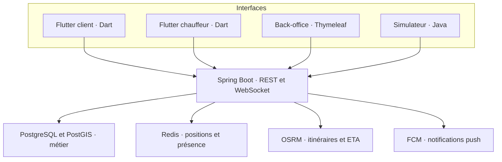
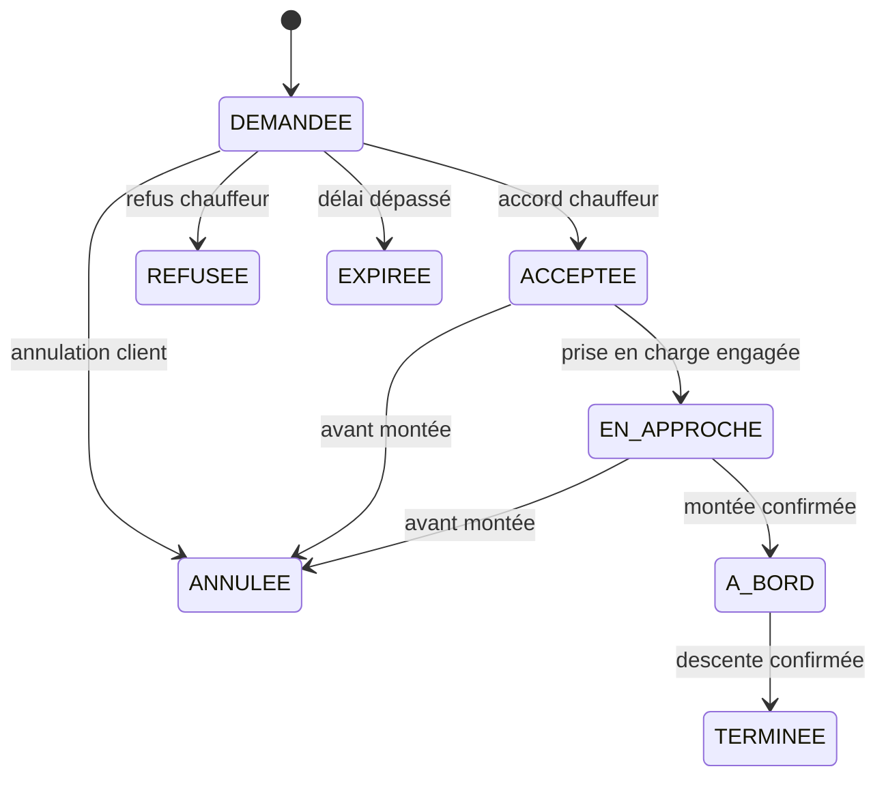

# Grand Taxi intra-ville — Planning Flutter pour 2 développeurs, répartition 50/50

**Projet :** PFA 5IIR, option Développement Digital et Systèmes d’Information, EMSI Rabat  
**Référence :** présentation « PFA – Grand Taxi intra-ville », 15 diapositives et leurs notes  
**Encadrant indiqué :** Pr. El Mehdi El Graoui  
**Version du plan :** 2.0 — 13 novembre 2026  
**Horizon :** 14 semaines relatives au démarrage officiel, à caler sur le calendrier de l’école  
**Équipe de référence :** binôme, Développeur 1 (D1) et Développeur 2 (D2)  
**Statut :** proposition de réalisation et de CDC détaillé à valider en S2.

## 1. Décisions retenues et répartition 50/50

**Deux applications mobiles en Flutter/Dart : une application client et une application chauffeur, avec une base de code partagée et deux flavors.** Ce choix suit la stack mobile suggérée dans la présentation. Le serveur reste en Java/Spring Boot : Flutter prend en charge les interfaces mobiles, tandis que le serveur garantit les réservations, les droits et les places disponibles.

Pour garder une charge maîtrisée à deux, le back-office reste en Spring MVC/Thymeleaf, dans le même serveur. Cela évite un troisième projet frontal. React/Vue est une suggestion du support ; le choix Thymeleaf reste une alternative à justifier dans le CDC.

### Stack retenue

| Composant | Choix | Livrable |
|---|---|---|
| Application client | Flutter/Dart, flavor `client` | APK client |
| Application chauffeur | Flutter/Dart, flavor `driver` | APK chauffeur distinct |
| Code mobile commun | Même projet Flutter : modèles, réseau, session, carte et composants | Pas de duplication des deux apps |
| API et logique métier | Java 21, Spring Boot, Spring Security | REST, WebSocket et stock transactionnel |
| Back-office | Spring MVC/Thymeleaf, CSS et carte Leaflet | Interface web admin/support |
| Base métier et géographique | PostgreSQL et PostGIS | Réservations, lignes et requêtes spatiales |
| État vivant et itinéraires | Redis, OSRM, OpenStreetMap | Positions, présence, ETA et carte |
| Notifications | FCM côté Flutter et SDK Admin côté serveur | Push et traitement de reprise |
| Simulateur et prévision | Java, exécutables séparés du mobile | Flotte, charge et prévision de demande |
| Livraison | Docker Compose et CI | Environnement de démonstration reproductible |

### Ce que signifie 50/50

La répartition porte sur **l’effort total estimé**, pas sur le nombre d’écrans ni sur le nombre de commits. Les deux développeurs participent au serveur, à Flutter, aux tests et au rapport. Chaque fonctionnalité a un responsable et un relecteur. Il n’y a pas de troisième développeur implicite ni de travail « commun » laissé sans budget.

| Développeur | Dominante | Travail planifié | Réserve | Capacité totale |
|---|---|---:|---:|---:|
| D1 | Réservations, application client, comptes, notifications, support, simulateur et évaluation IA | 420 h | 105 h | 525 h |
| D2 | Courses, application chauffeur, flotte, géospatial, temps réel et administration du réseau | 420 h | 105 h | 525 h |
| **Total** | **50 % / 50 %** | **840 h** | **210 h** | **1 050 h** |

**Planning principal : 14 semaines, avec 37,5 h disponibles par personne et par semaine**, soit 30 h planifiées et 7,5 h de réserve. Le support donne 14 semaines à titre indicatif et recommande plutôt un trinôme : le passage à deux impose d’expliciter cette disponibilité. Le choix Flutter ne justifie pas, à lui seul, de réduire arbitrairement la charge.

À **25 h par personne et par semaine**, prévoir **21 semaines** avec la même charge et la même réserve. À **20 h**, prévoir environ **27 semaines**. Le calendrier détaillé de la section 16 décrit le scénario 14 semaines ; les dates réelles restent à aligner avec l’école.

### Respect du CDC

La présentation est un support de lancement qui demande elle-même un CDC validé en S2. Ce plan couvre les exigences extraites des 15 diapositives et de leurs notes ; aucun CDC officiel séparé ni logiciel exécutable n’a été fourni. La conformité du logiciel devra être démontrée par les recettes R01–R26.

La version de référence est **Android**, avec code Flutter portable. Une livraison iOS signée et testée n’est pas incluse dans les 840 h : elle demande notamment un Mac/Xcode, des appareils et la configuration Apple/FCM adaptée [T15]. Si iOS devient obligatoire, ajouter sa charge et conserver une répartition égale. Une application Flutter n’a pas besoin de Firebase Auth ou Firestore pour fonctionner : l’authentification et les données métier restent dans Spring Boot/PostgreSQL.

## 2. Objectif métier et limites du projet

Permettre à un passager de trouver un grand taxi qui circule déjà sur une ligne urbaine, réserver **une à six places**, obtenir l’accord du chauffeur et suivre son arrivée. Le véhicule reste partagé entre plusieurs passagers. Le projet ne repose pas sur la privatisation complète du taxi.

Le chauffeur déclare une course sur une ligne orientée, indique l’occupation initiale, accepte/refuse les demandes puis confirme les montées et descentes. L’administration gère chauffeurs, véhicules, agréments, villes et lignes. Le support traite signalements, suspensions et litiges.

### Niveaux de livraison

| Niveau | Contenu | Échéance |
|---|---|---|
| Noyau démontrable | Comptes, validation chauffeur, lignes, inventaire de places, réservation complète, position et simulateur | S7 |
| Parcours complet | Deux APK, back-office, push, historique, notes, support, paiement espèces | S10 |
| Version complète du sujet | Appariement classé, trajets croisés sur tronçons partagés, module de prévision, preuves de charge et de reprise réseau | S12 |
| Livraison académique | Installation reproductible, rapport, UML, guide, soutenance et démonstration de secours | S14 |

Le noyau S7 est un jalon intermédiaire. Il ne représente pas à lui seul la conformité à tout le sujet.

### Extensions hors engagement initial

Paiement en ligne, livraison iOS signée et testée, tarification dynamique, portefeuille, SMS payant, navigation vocale développée sur mesure, réservation avec correspondance entre deux taxis, détour arbitraire hors ligne, microservices et Kubernetes. Le sujet permet de limiter les trajets croisés aux lignes partageant un tronçon : cette variante est incluse dans la version complète, et doit apparaître dans le CDC validé.

## 3. Analyse à réaliser avant de figer le CDC

Les nombres ci-dessous sont des objectifs d’étude proposés, pas des consignes imposées par le support.

| Travail S1–S2 | Résultat attendu | Décisions alimentées |
|---|---|---|
| Entretiens avec 5–8 chauffeurs | Synthèse anonymisée, règles d’occupation, arrêts et disponibilité | Attente en station, départ, montées spontanées, refus |
| Entretiens avec 8–12 usagers | Besoins, confiance, délai toléré, difficultés d’usage | Annulation, suivi, choix du point de rendez-vous |
| Relevé de 2–3 lignes réelles à Rabat | Tracé orienté, stations, arrêts usuels, photos autorisées si utiles | Direction, corridor, tronçons partagés |
| Analyse de 3 applications de mobilité | Tableau comparatif avec la réservation de places partagées | Fonctions utiles et différences du modèle |
| Atelier avec l’encadrant | Compte rendu des arbitrages | CDC, stack Flutter/Spring Boot, disponibilité du binôme et critères de recette |

Agdal–Hay Riad est un **exemple du support**, pas une ligne déjà vérifiée. Les lignes de démonstration doivent être observées et validées avant leur intégration.

### Registre des décisions à valider

| ID | Question | Proposition de départ | Effet si elle change |
|---|---|---|---|
| D01 | Deux applications ou une seule avec rôles ? | Deux APK Flutter, flavors client et driver dans un projet commun | Packaging et navigation |
| D02 | Qui détient l’agrément ? | Entité agrément liée au véhicule, titulaire distinct du chauffeur | Modèle et validation administrative |
| D03 | Quand une place est-elle bloquée ? | Dès `DEMANDEE`, avec expiration à 60 s | Inventaire et UX de réservation |
| D04 | Annulation client ? | Autorisée avant `A_BORD`, sans paiement numérique ni pénalité automatique | États et support |
| D05 | Tarif par place ? | Tarif de référence validé par ligne, affiché avant la demande, règlement espèces | Modèle tarifaire et écrans |
| D06 | Lignes croisées ? | Un seul taxi, tronçon commun dans le même sens, aucun transfert | Algorithme et jeux de recette |
| D07 | Attribution des places ? | Stock global conservateur par course, libéré à la descente confirmée | Capacité commerciale et complexité |
| D08 | Passagers sans application ? | Occupation externe déclarée par le chauffeur à l’arrêt | Fiabilité du stock réel |
| D09 | Client absent ou course interrompue ? | Traitement explicite à l’arrêt avec motif, conservation de l’historique | Transitions et libération de places |
| D10 | Attente au départ ? | États distincts « en station » et « en route » | Sens de parcours et ETA |
| D11 | Durées de conservation et accès aux données ? | Politique écrite et configurable, comptes de démonstration synthétiques | Suppression, audit et exploitation |
| D12 | Charge, délais et appareils cibles ? | Objectifs proposés en section 17 | Configuration et preuve de performance |

Ces décisions sont à trancher pendant le projet. Elles ne bloquent pas l’utilisation de ce plan comme document de travail.

## 4. Matrice de couverture des exigences du support

**Lecture :** « prévu » signifie couvert par une tâche et une recette à venir. Aucun test logiciel n’a été exécuté dans le cadre de la rédaction de ce plan. Les références « D. » désignent les diapositives du fichier fourni.

| ID | Exigence et source | Réalisation prévue | Jalon | Preuve de recette | Responsable |
|---|---|---|---|---|---|
| E01 | Ville, position, départ/destination — D.6 | Recherche manuelle ou GPS, ligne orientée | S9 | R01 | D1 |
| E02 | Trouver les taxis sur le trajet — D.6, D.10 | Filtrage spatial, sens, disponibilité, fraîcheur | S7 puis S12 | R02 | D2 moteur ; D1 UI client |
| E03 | Réserver 1–6 places — D.4, D.6 | Commande transactionnelle avec blocage temporaire | S7 | R03, R04 | D1 |
| E04 | Accepter ou refuser — D.5–8 | Actions chauffeur autorisées, notification client | S7 | R05 | D1 API ; D2 UI chauffeur |
| E05 | Cycle de vie complet et sorties — D.8 | Machine à états, annulation, refus, expiration | S7 | R06, R07 | D1 |
| E06 | Cohérence sous concurrence — D.8 | Verrou de course et contraintes PostgreSQL | S7 | R04, R07 | D1, revue D2 |
| E07 | Suivi jusqu’à la prise en charge — D.6, D.9 | WebSocket, position Redis, reprise REST | S10 | R08, R09, R26 | D2 transport ; D1 suivi client |
| E08 | Espèces, historique, avis — D.6 | Tarif de référence, historique, avis après trajet | S10 | R10 | D1 |
| E09 | Notifications push — D.6, D.9, D.11 | FCM et notifications persistées | S10 | R11, R25 | D1, intégration chauffeur D2 |
| E10 | Déclarer trajet et places — D.7 | Ligne, véhicule validé, course, occupation externe | S7 | R12 | D2 |
| E11 | Clients sur la route — D.7 | Carte des rendez-vous utiles à la course | S10 | R13 | D2 |
| E12 | Montées, déposes, places libérées — D.7 | Confirmation métier, recalcul et diffusion automatiques | S10 | R06, R12 | D1 stock ; D2 UI |
| E13 | Navigation, gros boutons, alertes — D.7 | Prochain arrêt, guidage, actions à l’arrêt, sons | S10 | R14 | D2 |
| E14 | Villes et lignes — D.4–5 | Back-office et géométries versionnées | S9 | R15 | D2 |
| E15 | Chauffeurs, véhicules, agréments — D.4–5 | Validation administrative, blocage des comptes non validés | S9 | R16 | D2 |
| E16 | Support, modération, litiges — D.4–5 | Signalements, traitement, suspension auditée | S10 | R17 | D1 |
| E17 | Statistiques — D.4–5, D.12 | Réservations, demande, occupation, annulations | S10 | R18 | D1 global ; D2 chauffeur |
| E18 | Appariement et classement — D.10 | Corridor, ordre, capacité, ETA, détour et note | S12 | R02, R19 | D2, validation D1 |
| E19 | Trajets croisés — D.6–7, D.10 et notes | Tronçon commun orienté, sans changement de taxi | S12 | R19 | D2 |
| E20 | REST, WebSocket, rôles JWT — D.11 | Spring Security et autorisation par ressource | S7 | R20 | D1 REST ; D2 WebSocket |
| E21 | PostgreSQL/PostGIS, Redis, OSM/OSRM — D.9–11 | Architecture décrite en sections 6, 10 et 11 | S7 | R02, R08, R21 | D1 base ; D2 Redis/spatial/OSRM |
| E22 | IA complémentaire — D.12 | Prévision ligne/créneau, baseline et évaluation temporelle | S12 | R22 | D1 modèle/mesures ; D2 UI chauffeur |
| E23 | Simulateur et charge — D.11, D.14 | Flotte et clients Java, scénarios déterministes | S7 puis S12 | R04, R23 | D1 simulateur ; D2 scénarios spatiaux |
| E24 | Terrain, CDC, UML, Git, rapport et démo — D.13–15 | Dossier de conception et livrables versionnés | S2 à S14 | R24 | D1 50 % / D2 50 % |
| E25 | Docker et CI/CD — D.11, D.14 | Build, tests, images, déploiement reproductible | S3 à S14 | R21 | D1 CI/base ; D2 livraison mobile/OSRM |

La conformité finale suppose : décisions D01–D12 validées, exigences E01–E25 démontrées, écarts explicités et critères officiels de l’école respectés.

## 5. Acteurs, permissions et écrans

| Acteur | Autorisations | Restrictions principales |
|---|---|---|
| Visiteur | Consulter les villes/lignes publiques, créer un compte | Pas de réservation ni de positions nominatives |
| Client | Réserver, annuler avant montée, suivre son taxi, historique, avis, signalement | Accès à ses réservations et à leur taxi uniquement |
| Chauffeur validé | Ouvrir sa course, traiter ses demandes, diffuser sa position, confirmer montées/descentes | Pas d’accès aux clients d’un autre chauffeur |
| Administrateur | Valider chauffeurs/véhicules/agréments, gérer villes/lignes, paramètres et statistiques | Actions sensibles journalisées |
| Support/modération | Traiter les signalements et litiges, suspendre selon permission attribuée | Pas de gestion technique des clés ni d’accès généralisé aux positions |
| Système | Expirer les demandes, actualiser les stocks, notifier, calculer les correspondances | Même service métier pour toutes les mutations de stock |

### Écrans de l’application client

1. Inscription, connexion, réinitialisation du mot de passe.
2. Choix de ville et position, avec alternative manuelle si GPS refusé.
3. Départ, destination, point de rendez-vous et nombre de places.
4. Liste/carte des taxis : places disponibles, attente estimée, note, tarif de référence.
5. Détail du taxi et confirmation de la demande, délai d’expiration visible.
6. Attente de réponse, acceptation/refus/expiration et annulation.
7. Suivi du taxi, fraîcheur de position, point de rendez-vous.
8. Trajet à bord puis récapitulatif en espèces.
9. Historique, détail, avis et signalement.
10. Notifications, profil et réglages de confidentialité.

### Écrans de l’application chauffeur

1. Connexion et état de validation du dossier.
2. Profil, véhicule et pièces administratives.
3. Choix de ligne/sens, occupation initiale, ouverture de course.
4. Tableau de bord : places libres, réservées et occupées.
5. Demandes avec actions accepter/refuser et alerte sonore.
6. Carte des prises en charge et déposes dans l’ordre du trajet.
7. Prochain arrêt, confirmation de montée/descente, ouverture du guidage.
8. Mise à jour des passagers sans application à l’arrêt.
9. Clôture de course, historique et statistiques simples.
10. Suggestions de lignes/créneaux selon la prévision.

### Écrans du back-office

Tableau de bord ; comptes et rôles ; dossiers chauffeurs ; véhicules et agréments ; villes/lignes/arrêts ; courses et réservations ; signalements/litiges ; statistiques et prévisions ; paramètres métier ; journal d’administration.

## 6. Architecture Flutter et technologies

### 6.1 Architecture générale

Un monolithe Spring Boot organisé par domaine garantit les transactions de réservation. Les deux apps Flutter utilisent le même contrat REST et le même protocole WebSocket. Redis sert à la présence et aux positions ; PostgreSQL reste la référence des réservations et des places.



### 6.2 Stack et dépendances minimales

| Besoin | Choix | Règle de mise en œuvre |
|---|---|---|
| UI mobile | Flutter stable, Dart fourni avec ce SDK | Version exacte figée en S3 |
| Deux applications | Flavors `client` / `driver`, points d’entrée distincts | Identifiants Android et configurations FCM distincts [T12] |
| État Flutter | Contrôleurs/ViewModels avec `ChangeNotifier` et écoute des changements | État local simple, pas de Bloc/Riverpod ajouté par défaut |
| Navigation | API de navigation Flutter | Routes gardées par session et rôle ; ouverture de notification contrôlée |
| REST mobile | Package `http`, un client partagé | Auth, timeout, renouvellement de session et erreurs homogènes [T14] |
| WebSocket mobile | `web_socket_channel` | Flux JSON, reconnexion, authentification et snapshot REST [T11] |
| Carte | `flutter_map` avec tuiles OSM configurables | Marqueurs, lignes, attribution et cache conforme [T8] |
| Localisation | Package `location`, configuration native vérifiée | Premier plan client, suivi chauffeur en cours de course [T16] |
| Push | `firebase_core` et `firebase_messaging` | Traitement foreground/background/ouverture, token par installation [T6] |
| Secrets sur téléphone | Stockage sécurisé adossé aux mécanismes de la plateforme | Plugin maintenu et compatibilité vérifiés pendant le spike S3 |
| Serveur | Java 21, Spring Boot 4.0.x, Maven Wrapper | Patch exact et dépendances verrouillés [T1] |
| Sécurité serveur | Spring Security, JWT mobile, session back-office | Contrôle du rôle et de la propriété sur chaque ressource |
| Données | PostgreSQL/PostGIS, JPA, SQL spatial ciblé, Flyway | Contraintes SQL et migrations versionnées |
| Temps réel serveur | WebSocket JSON natif et Redis | Une instance pour le PFA, aucune logique de stock dans Redis |
| Itinéraires | OSRM sur extrait régional | Calcul borné des ETA, pas de trafic routier temps réel [T4] |
| Back-office | Thymeleaf et Leaflet pour les cartes | Intégré au serveur, permissions admin/support |
| Tests mobiles | `flutter_test` et `integration_test` | Unitaire, widget et parcours ciblés [T13] |
| Tests serveur | JUnit, Spring Boot Test et Testcontainers | Vraie base PostgreSQL/PostGIS pour stock et géospatial |
| Simulateur/charge | Java, mêmes API que les apps | Scénarios déterministes et concurrence |
| CI/CD | GitHub Actions et Docker Compose | Analyse Flutter, builds, tests, JAR/APK et déploiement |

Choisir un seul plugin de localisation au départ. Ajouter un autre mécanisme natif seulement si le spike prouve une limite concrète. Les règles de localisation en arrière-plan dépendent des versions Android et du plugin ; un timer Dart ne garantit pas le suivi écran éteint.

Les données OSM sont ouvertes, mais les serveurs publics de tuiles ont une politique d’utilisation. Prévoir attribution, cache et fournisseur configurables ; aucun test de charge sur leurs serveurs [T7].

### 6.3 Structure du dépôt et responsables

| Chemin | Contenu | Responsable principal |
|---|---|---|
| `backend/` | Serveur Spring Boot et templates back-office | D1 pour comptes/réservations ; D2 pour flotte/courses/géospatial |
| `mobile/lib/main_client.dart` | Entrée de l’app client | D1 |
| `mobile/lib/main_driver.dart` | Entrée de l’app chauffeur | D2 |
| `mobile/lib/core/` | Réseau, session, configuration, design commun | Propriété détaillée ci-dessous |
| `mobile/lib/features/client/` | Recherche, réservation, suivi client, historique, avis | D1 |
| `mobile/lib/features/driver/` | Course, demandes, suivi chauffeur, montées/descentes | D2 |
| `mobile/lib/features/auth/` | Connexion, profil, reprise de session | D1 ; D2 intègre au flavor chauffeur |
| `mobile/android/` | Flavors, manifests et configuration native | D2 ; revue D1 |
| `mobile/test/`, `mobile/integration_test/` | Preuves des composants et parcours | Auteur de la fonctionnalité, revue de l’autre |
| `simulator/` | Flotte et clients Java | D1 ; D2 fournit routes et protocole de position |
| `infra/` | Compose, proxy, OSRM, sauvegarde | D1 pour CI/base ; D2 pour OSRM/déploiement mobile |
| `docs/` | CDC, UML, contrats, recettes, rapport et guides | Sections attribuées aux deux |

Dans Flutter, séparer UI et accès aux données, sans recopier une architecture lourde pour chaque écran [T17]. Un ViewModel de réservation gère son état d’affichage et appelle l’API ; il ne décide pas si le taxi dispose réellement de places.

### 6.4 Propriété du code partagé

| Élément partagé | Responsable | Contribution attendue de l’autre |
|---|---|---|
| Client REST, session, stockage de jetons, erreurs | D1 | D2 relit et branche le parcours chauffeur |
| Client WebSocket, reconnexion, localisation et carte commune | D2 | D1 relit et branche le suivi client |
| Modèles Dart `Booking`, transitions et prix | D1 | D2 valide le rendu côté chauffeur |
| Modèles `Trip`, `RoutePattern`, `Vehicle` et positions | D2 | D1 valide la recherche et le simulateur |
| Thème, boutons, chargement, écrans d’erreur | D1 | D2 définit les contraintes d’usage chauffeur |
| Manifest/flavors et configuration des deux apps | D2 | D1 vérifie le build client et l’absence de permission excessive |
| Service unique de stock et machine à états | D1 | D2 appelle ce service pour montées/descentes et occupation externe |
| Contrats OpenAPI/événements | Auteur du domaine | Relecture obligatoire avant modification incompatible |

Les deux développeurs modifient le même dépôt via de petites branches et demandes de fusion. Le responsable d’un fichier commun coordonne son évolution ; cela ne lui interdit pas les contributions de l’autre. Une relecture consomme le budget du relecteur.

### 6.5 Packaging et environnements Flutter

Deux flavors, deux points d’entrée, une seule base de code. Les noms `client` et `driver` identifient le produit ; l’URL de l’API et les réglages de démonstration passent dans une configuration d’environnement, par exemple `--dart-define`. Ces valeurs embarquées ne sont pas un stockage de secrets.

Les commandes suivantes sont les cibles à rendre exécutables en S3, pas des builds déjà réalisés :

```bash
flutter run --flavor client -t lib/main_client.dart
flutter run --flavor driver -t lib/main_driver.dart
flutter build apk --flavor client -t lib/main_client.dart
flutter build apk --flavor driver -t lib/main_driver.dart
```

Chaque flavor possède son nom, icône, identifiant et configuration Firebase. Retirer du flavor client les permissions de suivi en arrière-plan non nécessaires. Le rôle reste vérifié côté serveur : choisir un flavor ne donne aucune permission supplémentaire.

### 6.6 Spike obligatoire en S3

D2 prouve les deux flavors, une carte, le GPS écran éteint sur téléphone et le WebSocket authentifié. D1 prouve connexion/renouvellement de session, REST, persistance et un push dans les deux apps. Les deux compilent les APK en mode release, vérifient les permissions fusionnées et figent versions Flutter/Dart, Gradle, JDK et plugins. Ne pas attendre S10 pour découvrir qu’un plugin cesse de fonctionner en arrière-plan.

## 7. Modèle de données prévu

### 7.1 Entités principales

| Entité | Champs clés | Règles |
|---|---|---|
| `User` | UUID, nom, téléphone/email, hash mot de passe, état | Identifiants normalisés, unicité, suspension |
| `UserRole` | utilisateur, rôle | Plusieurs rôles possibles, attribution contrôlée |
| `DriverProfile` | utilisateur, validation, références de dossier | Validation avant ouverture de course |
| `Vehicle` | immatriculation, capacité, état | Capacité entre 1 et 6, immatriculation unique |
| `Permit` | référence agrément, titulaire, véhicule, validité, statut | Modèle ajusté après étude de terrain |
| `DriverVehicleAssignment` | chauffeur, véhicule, dates | Historique des affectations et contrôle à l’ouverture |
| `City` | nom, périmètre pilote | Ville active |
| `Line` | ville, nom commercial, tarif de référence | Ligne logique, peut avoir deux sens |
| `RoutePattern` | ligne, sens, version, `LineString(4326)` | Tracé orienté immuable pour les courses existantes |
| `Stop` et `RouteStop` | point, route, ordre | Ordre explicite, positions de montée/dépose |
| `RouteOverlap` | deux routes, limites des tronçons communs, sens | Tronçon parcourable dans le même sens |
| `Trip` | chauffeur, véhicule, route/version, état, capacité, compteurs | Une course active par chauffeur et véhicule |
| `Booking` | client, course, places, départ, destination, projections, état | 1–6 places, dates, tarif figé, expiration |
| `BookingEvent` | réservation, ancien/nouvel état, acteur, motif, date | Historique append-only des transitions |
| `DeviceToken` | utilisateur, installation, jeton FCM, date | Rotation et désactivation des jetons invalides |
| `Notification` | destinataire, type, référence, envoi, tentative | Trace persistante, reprise des pushes |
| `Rating` | réservation, client, chauffeur, note, commentaire | Un avis client par réservation terminée |
| `Report` | auteur, cible, réservation, motif, état | Traitement par support |
| `AuditLog` | acteur administratif, action, objet, date | Validation, suspension, modification sensible |
| `IdempotencyRecord` | utilisateur, opération, clé, hash requête, résultat | Unicité et détection des répétitions divergentes |
| `DemandForecast` | route, créneau, version modèle, estimation | Prédiction datée, reproductible |

### 7.2 Relations et contraintes indispensables

- Une ville possède plusieurs lignes ; une ligne possède des tracés orientés versionnés.
- Une course appartient à un seul chauffeur, un véhicule et une version de tracé.
- Une réservation appartient à une course et un client ; ses points et son tarif sont figés à la création.
- Index partiels uniques sur chauffeur et véhicule pour les courses actives.
- Index sur `(trip_id, status)`, `(client_id, created_at)`, `(status, expires_at)` et `(route_id, created_at)`.
- Index GiST adapté aux recherches de corridor. Si le filtre utilise `geom::geography`, créer l’index d’expression correspondant.
- Contraintes SQL sur capacité, places, compteurs positifs et somme des places mobilisées.
- Index unique d’idempotence et d’avis. Clés étrangères pour les relations métier.
- Fichiers d’agrément hors dossier public, avec référence en base et accès autorisé.
- Désactivation/versionnement des lignes référencées plutôt que suppression qui casserait les historiques.
- Instants enregistrés en UTC ; affichage et agrégation des créneaux avec le fuseau `Africa/Casablanca`, sans décalage horaire fixe codé en dur.
- Montants en MAD, stockés en décimal et manipulés avec `BigDecimal` côté Java ; tarif par place et total figés dans la réservation.

Les positions courantes sont stockées dans Redis avec horodatage et TTL. Un historique GPS exhaustif n’est pas nécessaire au noyau. Les événements de réservation et agrégats temporels suffisent à la prévision initiale.

### 7.3 Dictionnaire de vocabulaire

**Ligne :** liaison métier. **Tracé :** géométrie et sens versionnés. **Course :** exécution par un chauffeur et un véhicule. **Réservation :** demande d’un client pour plusieurs places. **Trajet croisé :** correspondance spatiale avec un autre tracé partageant un tronçon ; ce n’est pas un changement de véhicule.

## 8. Règles métier et cycle de vie

### 8.1 États d’une réservation



| Transition | Acteur | Conditions | Effet sur les places |
|---|---|---|---|
| Création vers `DEMANDEE` | Client | Chauffeur validé, course active, correspondance valable, capacité suffisante | Ajout au stock bloqué |
| `DEMANDEE` vers `ACCEPTEE` | Chauffeur propriétaire | Avant expiration, état inchangé | Aucun changement de stock |
| `DEMANDEE` vers `REFUSEE` | Chauffeur propriétaire | Demande encore active | Libération du blocage |
| `DEMANDEE` vers `EXPIREE` | Système | Heure serveur supérieure ou égale à l’échéance | Libération du blocage |
| Avant montée vers `ANNULEE` | Client propriétaire | État autorisé | Libération du blocage |
| `ACCEPTEE` vers `EN_APPROCHE` | Chauffeur | Action « aller au rendez-vous », demande encore active | Aucun changement de stock |
| `EN_APPROCHE` vers `A_BORD` | Chauffeur | Confirmation à l’arrêt ; toutes les personnes de la réservation montent | Blocage converti en occupation |
| `A_BORD` vers `TERMINEE` | Chauffeur | Descente confirmée à l’arrêt | Libération automatique des places occupées |

Le chauffeur peut enchaîner « en approche » et « montée » à l’arrêt si le client est déjà présent, mais le serveur journalise les deux transitions. Les états terminaux sont immuables. L’app n’annonce aucun succès définitif sans réponse serveur.

### 8.2 Cas particuliers à traiter

- **Annulation et montée simultanées :** le verrou de course sérialise les opérations ; la seconde commande reçoit l’état réellement obtenu.
- **Acceptation tardive :** le service vérifie `expires_at` dans la transaction ; le retard du job d’expiration ne prolonge pas la demande.
- **Client absent :** option proposée `ANNULEE` avec motif `NO_SHOW`, uniquement après action explicite à l’arrêt. Ne pas inventer une descente.
- **Course interrompue :** notifier et annuler les demandes avant montée avec motif ; garder les passagers à bord occupés jusqu’à confirmation de leur descente et traiter l’incident au support.
- **Suspension :** interdire toute nouvelle activité ; traiter les courses en cours par une procédure d’incident sans effacer leur historique.
- **Fin de course :** interdite tant qu’il reste des réservations actives ou des passagers déclarés à bord.
- **Modification de trajet :** ne pas modifier silencieusement un tracé déjà accepté. Le noyau utilise des lignes fixes ; une nouvelle version ne s’applique qu’aux futures courses.
- **Réservation d’un groupe :** montée et descente du groupe ensemble. Les déposes partielles par personne sont une extension.

## 9. Gestion des places et concurrence

### 9.1 Inventaire explicite

Pour une course :

```text
C = capacité passagers du véhicule, au maximum 6
H = places bloquées par DEMANDEE, ACCEPTEE et EN_APPROCHE
B = places des réservations A_BORD
X = passagers à bord sans réservation numérique
F = places encore disponibles = C - H - B - X

Invariant : 0 <= H + B + X <= C, donc F >= 0
```

Exemple : capacité 6, un passager externe, une réservation acceptée de deux places. `X=1`, `H=2`, `B=0`, `F=3`. À la montée du groupe : `H=0`, `B=2`, `F=3`. À sa descente : `B=0`, `F=5`.

Le chauffeur saisit l’occupation réelle initiale. L’application calcule les places libres. Toute mise à jour d’occupation externe passe par la même transaction que les réservations : ajouter un passager externe est refusé si cela consommerait une place déjà bloquée.

**Choix conservateur à valider :** une réservation bloque des places sur toute la course jusqu’à la descente. Le système ne vend pas par anticipation une place qui devrait se libérer plus loin. Il peut donc proposer moins de réservations que ne le permettrait une allocation par tronçon, mais il préserve la capacité. L’allocation par segment est une extension distincte, qui exigerait des contraintes et tests supplémentaires.

### 9.2 Algorithme transactionnel prévu

Toutes les opérations qui modifient `H`, `B`, `X` ou une réservation active verrouillent d’abord **la même ligne `Trip`** dans PostgreSQL, via `SELECT ... FOR UPDATE` ou `PESSIMISTIC_WRITE`. Le verrou dure jusqu’au commit [T2].

Pour créer une réservation :

1. Vérifier l’identité, les entrées, le nombre de places et la clé d’idempotence.
2. Ouvrir une transaction courte et verrouiller la course.
3. Rechercher de nouveau la clé d’idempotence : une répétition identique retourne la réservation existante ; un contenu différent avec la même clé donne `409`.
4. Contrôler la course, les validations, la fraîcheur de position et la correspondance sur la version de route attendue.
5. Expirer sous ce verrou les demandes échues de la course et ajuster `H`.
6. Recalculer `F`. Si `F < nombreDemandé`, refuser sans réservation partielle.
7. Créer `DEMANDEE`, son échéance et l’événement ; incrémenter `H`.
8. Enregistrer le résultat d’idempotence et la notification dans la même transaction.
9. Commit, puis diffusion WebSocket et tentative de push.

Le calcul réseau OSRM se fait **avant** le verrou avec un délai court ; la transaction recontrôle les données variables. Aucun appel FCM ou OSRM ne doit prolonger un verrou métier.

### 9.3 Protections nécessaires

- Le job d’expiration, le support, les montées/descentes et les corrections chauffeur utilisent tous ce protocole.
- Pour modifier plusieurs courses, verrouiller dans un ordre stable. Une seule course est normalement concernée.
- Une transition vérifie l’état courant avant tout incrément/décrément ; une répétition ne libère jamais deux fois la même place.
- Contraintes `CHECK` sur les compteurs et somme ; journal des transitions pour contrôler leur cohérence avec les réservations.
- Vérification de réconciliation en lecture entre compteurs et réservations ; une divergence génère une alerte et bloque la vente jusqu’à correction contrôlée.
- Redis ne sert pas de verrou de réservation et ne décide pas du nombre de places.
- Les résultats d’une recherche sont indicatifs ; le dernier contrôle se fait à la création. Une course affichée à une place peut être complète quelques secondes plus tard.
- Attente maximale sur verrou et erreur de concurrence explicite ; une relance conserve la même clé d’idempotence.

**Preuve attendue :** 100 clients distincts demandent simultanément une place sur une course initialement vide de capacité 6. Sans expiration pendant l’essai, exactement 6 demandes sont créées, les autres reçoivent un refus de capacité et les compteurs correspondent aux réservations. Répéter avec des groupes et des libérations concurrentes.

## 10. Temps réel, localisation et notifications

### 10.1 Flux prévu

1. Le chauffeur ouvre sa course en ligne.
2. Son application transmet ses coordonnées, précision, séquence et horodatage au WebSocket authentifié.
3. Le serveur contrôle l’identité, la course, les bornes GPS, l’ordre des messages et la plausibilité.
4. Il enregistre la dernière position dans Redis avec `receivedAt` serveur et un TTL.
5. Il envoie la position uniquement aux clients autorisés à suivre cette course.
6. Les changements de réservation sont persistés dans PostgreSQL puis diffusés.
7. FCM informe des événements importants ; à l’ouverture d’un push, l’app relit l’état courant par REST.

Les recherches anonymisent les informations inutiles. Les positions précises des clients ne sont accessibles au chauffeur que pour ses réservations utiles. Une recherche ne publie pas les coordonnées de tous les utilisateurs qui regardent une ligne.

### 10.2 Paramètres de départ proposés

| Paramètre | Valeur initiale | Vérification |
|---|---|---|
| Envoi GPS en mouvement | Toutes les 5 s, adaptation possible | Latence, réseau et batterie sur téléphone |
| Envoi à l’arrêt | Toutes les 15 s | Présence suffisamment fraîche |
| Position périmée | Après 30 s sans réception | Afficher « position ancienne », exclure des nouveaux résultats |
| Expiration Redis | 60 s | Suppression de la présence sans effacer les réservations |
| Demande sans réponse | 60 s | Horloge serveur, valeur configurable |
| Vérification des expirations | Toutes les 5 s | Acceptation protège aussi l’échéance directement |
| Reconnexion | Délai progressif 1, 2, 4… jusqu’à 30 s, avec aléa | Éviter les reconnexions simultanées massives |
| Repli REST en suivi | Toutes les 10 s si WebSocket indisponible | Signaler la dégradation et limiter le polling |

Ces valeurs ne proviennent pas du CDC : elles doivent être mesurées et justifiées.

### 10.3 Réseau faible et reprise

- Après reconnexion, relire un snapshot REST de la réservation et de la course avant de reprendre les événements.
- Chaque événement comporte `eventId`, `entityId`, `entityVersion` et date serveur ; ignorer les doublons et anciens états.
- La séquence GPS est liée à une session de suivi, pour accepter un redémarrage sans rejouer d’anciens points.
- Ne pas renvoyer un historique GPS comme une position actuelle : conserver seulement le point récent utile.
- Les actions sensibles hors ligne restent en état local « non confirmée ». Elles ne modifient pas l’inventaire avant accusé serveur.
- Si le chauffeur perd le réseau, les nouvelles demandes sont suspendues après le seuil de fraîcheur. Les réservations existantes restent visibles depuis le dernier snapshot, avec avertissement.
- Redis indisponible : marquer le suivi indisponible et suspendre l’appariement vivant. Les données métier durables restent disponibles.
- Redémarrage du serveur : restaurer les réservations depuis PostgreSQL ; les chauffeurs republient leur présence.

### 10.4 Flutter, cycle de vie et notifications

D2 intègre le suivi chauffeur avec le plugin `location` et la configuration Android native appropriée. Le suivi démarre depuis l’interface visible, reste signalé à l’utilisateur et s’arrête à la fin de course. Le mode arrière-plan et ses permissions doivent être validés sur les versions ciblées ; ne pas confondre la permission de premier plan Android avec le mode propre au plugin [T5, T16]. Le flavor client n’a pas besoin d’un GPS permanent pour recevoir la position du taxi.

Un WebSocket ouvert par le moteur Flutter peut être interrompu lorsque le système suspend l’application. Prévoir pour le chauffeur une remontée HTTPS authentifiée des positions si le canal n’est pas disponible dans le service de suivi ; elle applique la même validation serveur. Si le spike ne prouve pas la continuité nécessaire, traiter explicitement ce risque au jalon S3. La fraîcheur côté serveur protège l’appariement même si le téléphone cesse d’émettre.

D1 intègre FCM côté Flutter : message au premier plan, handler d’arrière-plan et ouverture à froid. Le handler d’arrière-plan respecte les contraintes du SDK et ne modifie pas directement l’UI ; l’application relit ensuite le snapshot métier [T6]. Gérer autorisation, rotation des jetons et configurations propres aux deux flavors. Un push n’est pas un accusé métier et son délai n’est pas garanti. La table de notifications et les reprises restent côté serveur.

Le déploiement PFA utilise une seule instance WebSocket. Si plusieurs instances deviennent nécessaires, le routage des connexions et la diffusion inter-instances constituent un travail supplémentaire. Redis Pub/Sub seul n’offre pas de rattrapage durable des messages manqués [T9] ; les snapshots restent indispensables.

## 11. Appariement et trajets croisés

### 11.1 Données géographiques

Stocker les coordonnées en WGS84, avec l’ordre **longitude, latitude** pour les points et OSRM. Conserver une géométrie orientée par sens. Utiliser `geography` ou une projection métrique adaptée pour les distances en mètres. Ne pas interpréter une distance en degrés comme une distance en mètres [T3].

Écarter du pilote les boucles ambiguës et les lignes dont les portions se superposent dans plusieurs sens, ou les découper en segments ordonnés. La projection au point le plus proche ne suffit pas à désambiguïser ces cas.

### 11.2 Pipeline de sélection

1. Filtrer par ville, course active, chauffeur/véhicule validés et position récente.
2. Retenir les courses dont la disponibilité indicative couvre le groupe demandé.
3. Vérifier départ et destination dans un corridor du tracé via `ST_DWithin` [T3].
4. Projeter taxi, point de montée et point de dépose sur le tracé orienté avec `ST_LineLocatePoint` [T10].
5. Vérifier l’ordre `taxi <= montée < dépose`, en tolérant un petit dépassement GPS défini en mètres. Le taxi doit encore pouvoir desservir le point.
6. Contrôler l’accessibilité réelle du point de montée et le sens routier. Une proximité à travers une route inaccessible ne suffit pas.
7. Calculer l’attente estimée et l’effet sur les rendez-vous déjà acceptés, sur le parcours restant et les arrêts obligatoires.
8. Classer les candidats, retourner les critères utiles à l’interface.
9. Revalider la disponibilité et la correspondance lors de la demande.

Pour OSRM, utiliser la séquence de points de passage représentant la ligne et ses arrêts. Une route la plus rapide entre deux points peut quitter la ligne métier ; vérifier le résultat et conserver le parcours contraint. OSRM fournit un itinéraire et une durée estimée, pas une garantie de temps d’arrivée [T4].

### 11.3 Classement proposé

Après élimination des candidats invalides, minimiser un score normalisé :

```text
score = 0,60 × attenteNormalisée
      + 0,30 × surcoûtNormaliséPourLesPassagersÀBord
      + 0,10 × pénalitéDeNote
```

Chaque composante est bornée entre 0 et 1. Une absence d’avis reçoit une valeur neutre documentée. En cas d’égalité, choisir l’ETA la plus faible puis un identifiant stable pour rendre le résultat reproductible.

| Paramètre | Proposition initiale | Justification à établir |
|---|---|---|
| Corridor de recherche | 300 m | Distance acceptable jusqu’à un arrêt accessible |
| Tolérance GPS longitudinale | 30 m le long du tracé | Limiter les exclusions dues au bruit GPS |
| Nombre de candidats avant OSRM | 20 maximum | Borner les calculs coûteux |
| Attente maximale proposée | 15 min | Étude usagers et scénarios |
| Détour géométrique hors ligne | 0 dans le périmètre de base | Trajets croisés limités au tronçon commun |
| Surcoût de prise en charge | Temps d’arrêt et marche/rendez-vous explicités | Respect des passagers déjà engagés |

Le filtre d’invalidité précède le score : une bonne note ne compense ni un mauvais sens ni une capacité insuffisante.

### 11.4 Trajets croisés inclus

Préparer les paires de tracés partageant un tronçon orienté et des points accessibles. Proposer le taxi si la montée et la dépose du client appartiennent à sa portion réellement desservie, dans le bon ordre. Exemple de test synthétique : ligne A de P à S et ligne B de Q à T, tronçon commun Q–R ; une demande Q–R peut correspondre aux deux lignes.

Un simple croisement à un carrefour ne permet pas à un taxi de desservir une destination hors de sa ligne. Une demande Q–T ne correspond pas à la ligne A si A quitte le tronçon commun avant T. Aucun transfert entre taxis n’est nécessaire dans cette version, conformément à la limitation possible indiquée dans les notes de D.10.

### 11.5 Recette de l’algorithme

Créer un jeu de cas étiquetés à la main : même ligne, sens inverse, taxi déjà passé, départ hors corridor, destination derrière le départ, tronçon commun, croisement ponctuel, taxi plein, GPS ancien et bord de seuil. Le résultat attendu de chaque cas doit être connu avant d’ajuster les poids.

## 12. Contrats REST et WebSocket

### 12.1 API indicative `/api/v1`

| Ressource | Opérations prévues | Points de contrôle |
|---|---|---|
| `/auth/register`, `/auth/login`, `/auth/refresh`, `/auth/logout` | Inscription, connexion, renouvellement, révocation | Limitation des tentatives et secrets hashés |
| `/me`, `/me/devices` | Profil et jetons de notification | Propriétaire uniquement |
| `/cities`, `/lines`, `/lines/{id}` | Consultation du réseau | Filtres et pagination |
| `/taxi-candidates` | Recherche départ/destination/places | Paramètres GPS validés, quota et résultats bornés |
| `/driver/trips` | Créer une course | Chauffeur et véhicule validés |
| `/driver/trips/{id}/start`, `/finish` | Démarrer/clôturer | Propriétaire, état et occupation |
| `/driver/trips/{id}/position` | Position HTTPS de repli pour le suivi | Même propriétaire, séquence et validation que WebSocket |
| `/driver/trips/{id}/external-occupancy` | Ajuster les passagers externes | Transaction de stock, action à l’arrêt |
| `/bookings` | Créer une demande | `Idempotency-Key`, stock et géométrie |
| `/bookings/{id}` | Snapshot de référence | Client propriétaire, chauffeur concerné ou support autorisé |
| `/bookings/{id}/accept`, `/reject` | Réponse chauffeur | Course du chauffeur, échéance |
| `/bookings/{id}/approach`, `/board`, `/complete` | Cycle de prise en charge | Transition autorisée, idempotence |
| `/bookings/{id}/cancel` | Annulation avant montée | Client propriétaire ; cas support avec motif |
| `/me/bookings`, `/driver/trips/{id}/bookings` | Historique et demandes | Pagination, filtre sur identité serveur |
| `/bookings/{id}/rating` | Évaluer | Réservation terminée et avis unique |
| `/reports` | Déclarer un incident | Référence contrôlée et pièces limitées |
| `/admin/...` | Villes, lignes, dossiers, modération, stats, prévisions | Permission fine et audit |
| `/driver/demand-forecast` | Lignes et créneaux prévus | Horodatage et nature simulée des données |

Prévoir également la réinitialisation de mot de passe par jeton à usage unique, sans dépendre d’un envoi SMS payant pour la démo. Le canal réel d’envoi doit être configuré ; un mode de démonstration local ne doit pas être exposé publiquement.

`201` pour création, `400` pour entrée invalide, `401/403` pour authentification/permission, `404` pour ressource non accessible, `409` pour capacité/état/idempotence conflictuelle et `429` pour quota. Erreurs structurées avec code métier stable et identifiant de corrélation, sans trace technique côté utilisateur.

### 12.2 Canal temps réel

**Transport retenu :** WebSocket JSON natif avec client Flutter [T11]. Sur Android, utiliser l’implémentation IO du package retenu pour transmettre le JWT au handshake ; le spike S3 vérifie cette interopérabilité avec Spring. Le serveur authentifie la connexion puis autorise chaque message/abonnement. La carte web du back-office utilise sa session sécurisée et une vérification d’origine. Ne pas placer le JWT dans une URL journalisable. Une future cible Flutter Web demanderait une stratégie de handshake adaptée aux restrictions du navigateur.

**Répartition :** D2 maintient le transport et les événements de position/course ; D1 maintient les événements de réservation/notification et les snapshots client. D1 publie après commit via le diffuseur commun maintenu par D2. Aucun des deux ne recopie les règles de stock dans le canal temps réel.

| Message | Sens | Destinataire autorisé |
|---|---|---|
| `LOCATION_UPDATE` | Chauffeur vers serveur | Course active du chauffeur |
| `SUBSCRIBE_BOOKING` | Client vers serveur | Sa propre réservation |
| `BOOKING_REQUESTED` | Serveur vers chauffeur | Propriétaire de la course |
| `BOOKING_STATUS_CHANGED` | Serveur vers client/chauffeur | Parties concernées |
| `TAXI_POSITION_UPDATED` | Serveur vers client | Réservation autorisée avant prise en charge |
| `TRIP_CAPACITY_CHANGED` | Serveur vers interfaces concernées | Données minimales de disponibilité |
| `TRIP_TRACKING_STALE` | Serveur vers client/chauffeur | Course concernée |

Les transitions métier restent des commandes REST. Le WebSocket diffuse leurs résultats et les positions ; il n’introduit pas une seconde implémentation des règles de réservation. Fermer ou réauthentifier la connexion à l’expiration du jeton, et couper l’accès après suspension.

## 13. Ergonomie chauffeur et sécurité applicative

### 13.1 Interaction en conduite

- Préparer ligne, véhicule et occupation avant le départ.
- Gros boutons, contraste lisible, textes courts et son distinct pour une demande.
- Afficher le prochain rendez-vous utile plutôt qu’une longue liste à parcourir.
- Limiter les actions complexes à l’arrêt. Le détecteur de mouvement est une aide UX, pas une preuve suffisante de sécurité.
- Ne pas imposer une réponse dans l’urgence : une demande peut expirer sans action du chauffeur.
- Confirmer montée/descente à l’arrêt ; le GPS seul ne prouve pas qu’un passager est monté ou descendu.
- « Places libérées automatiquement » signifie que le serveur libère et diffuse le stock après confirmation de descente, sans ressaisie du compteur.
- Fournir une carte avec ordre des arrêts et guidage vers le prochain point ; l’ouverture d’un navigateur GPS externe est une solution de base à valider en S2, en conservant l’ordre métier des arrêts.

### 13.2 Mesures de sécurité à intégrer

| Sujet | Mesure prévue | Recette |
|---|---|---|
| Mots de passe | Hash via Spring Security, jamais en clair | Vérification stockage et logs |
| Sessions mobiles | JWT d’accès court, refresh révocable stocké sous forme hashée | Expiration, rotation et déconnexion |
| Stockage téléphone | Keystore et stockage protégé selon versions ciblées | Extraction de logs et inspection debug |
| Back-office | Cookie Secure/HttpOnly/SameSite, protection CSRF | Requête intersite refusée |
| Autorisations | Rôle et propriété sur chaque ressource et abonnement | Tentatives entre comptes distincts |
| Validation chauffeur | Vérification compte, véhicule et agrément avant activité | Dossier refusé ou expiré |
| Transport | HTTPS/WSS, bases non exposées directement | Inspection du déploiement |
| Téléversements | Taille/type contrôlés, noms générés, accès privé | Fichier inattendu ou trop gros refusé |
| Secrets | Variables d’environnement, aucun secret dans Git/APK | Recherche de secrets et configuration |
| Localisation | Collecte pendant la course, accès limité, conservation définie | Arrêt du suivi et droits |
| Abus | Limite de connexions, réservations actives et recherche | Spam et demandes bloquantes |
| Journalisation | Identifiants métier, pas de mot de passe/JWT/positions détaillées inutiles | Inspection des journaux |

Proposition anti-abus : une réservation active par compte client dans le pilote, incluant le groupe de 1–6 personnes. Cette restriction doit être validée dans le CDC. Les comptes administrateur et support ne se créent pas via l’inscription publique.

Le projet doit documenter ses choix de protection des données avant un pilote avec de vraies personnes. Ce plan technique ne prétend pas attester la conformité juridique d’un futur service de transport.

## 14. Simulateur Java de taxis et de clients

Le simulateur est un livrable du sujet et un outil de développement. Commencer sa version minimale en S5, sans attendre les applications mobiles.

### Fonctionnement prévu

- Charger des tracés et arrêts réellement validés ou des fixtures synthétiques clairement identifiées.
- Créer des comptes et véhicules de démonstration via un mécanisme réservé à l’environnement de test.
- Faire progresser dix taxis virtuels le long de leurs géométries à vitesse paramétrable.
- Publier les positions par le même WebSocket que l’application chauffeur.
- Créer des clients aux points de prise en charge et envoyer leurs commandes par REST.
- Simuler acceptation/refus, montée, descente, expiration et perte réseau.
- Utiliser une graine aléatoire fixée et une horloge de scénario, tout en respectant les échéances du serveur.
- Exporter les événements et mesures en CSV/JSON, avec configuration et version du code.

### Scénarios obligatoires

| ID | Scénario | Observation attendue |
|---|---|---|
| SIM01 | 10 taxis, 2–3 lignes, demandes ordinaires | Réservation et suivi complets |
| SIM02 | 100 clients sur les 6 places d’une course | Aucune surréservation |
| SIM03 | Groupes de 2, 3 et 6 places concurrents | Acceptation atomique des groupes |
| SIM04 | Chauffeur silencieux | Expiration et places restituées |
| SIM05 | Coupure réseau 60 s puis reprise | Position ancienne signalée, snapshot cohérent |
| SIM06 | Montées/descentes numériques et externes | Inventaire correct |
| SIM07 | Lignes croisées, sens inverse, destination incompatible | Appariement conforme aux cas étiquetés |
| SIM08 | Pics matin et sortie des bureaux, heures creuses | Jeu synthétique exploitable pour la prévision |

Les tests de charge n’appellent ni FCM ni les serveurs publics de cartes. Utiliser des doubles pour les notifications et OSRM auto-hébergé ou des réponses de scénario pour isoler les mesures. Conserver un test d’intégration réel séparé pour chaque service externe.

## 15. Module complémentaire de prévision en Java

### 15.1 Cible et données

Prédire le **nombre de passagers demandés** par ligne orientée et par créneau de 30 minutes. Compter les places demandées à la création, avec statut conservé pour analyser les annulations. Distinguer demande, réservations acceptées et passagers effectivement transportés : une ligne saturée ne doit pas paraître peu demandée parce qu’elle refuse des clients.

Créer une grille complète ligne/créneau incluant les zéros. Utiliser jour de semaine, créneau, indicateur de jour férié renseigné et historique disponible. La météo reste optionnelle, comme dans le support. Toutes les caractéristiques de prédiction doivent être connues au moment où la prévision est produite.

### 15.2 Démarche minimale

1. Générer plusieurs semaines synthétiques : pics, variations et bruit, sans présenter ces données comme du terrain réel.
2. Établir une baseline : moyenne du même créneau et même type de jour dans les semaines passées.
3. Entraîner un modèle simple de régression en Java, par exemple via une bibliothèque JVM maintenue dont licence et compatibilité seront vérifiées au démarrage de ce lot.
4. Séparer chronologiquement entraînement, validation et test. Aucun découpage aléatoire qui mélange futur et passé.
5. Comparer MAE et RMSE sur les mêmes périodes, par ligne et au global ; borner les prédictions à une valeur non négative.
6. Retenir le modèle selon les résultats. S’il ne bat pas la baseline, afficher ce constat et conserver la solution la plus fiable.
7. Enregistrer version, période d’apprentissage, configuration, métriques et prévisions.
8. Afficher au back-office et chez le chauffeur les créneaux à forte demande, avec date de mise à jour.

Un modèle entraîné et évalué uniquement sur le simulateur démontre la démarche d’intégration. Il ne prouve pas une qualité prédictive sur les déplacements réels à Rabat. L’absence d’amélioration par rapport à la baseline est un résultat à expliquer, pas à masquer.

**Recette IA :** pipeline reproductible, absence de fuite temporelle, tableau comparatif, prévisions visibles et étiquette « données simulées ». Le module IA ne doit pas retarder la fiabilité des places ou du suivi.

## 16. Planning complet pour deux développeurs, 50/50

### 16.1 Responsabilités par fonctionnalité

La répartition est conçue pour que chacun possède des parcours de bout en bout. D1 a une dominante réservation/client et D2 une dominante course/chauffeur. Chaque développeur livre aussi les tests, contrats et pages d’administration liés à ses domaines.

| Domaine | D1 réalise | D2 réalise | Règle d’intégration |
|---|---|---|---|
| Terrain et CDC | Usagers, benchmark, réservation, cas d’usage client | Chauffeurs, lignes réelles, course et contraintes d’usage | Un CDC commun relu par les deux |
| Conception | Comptes, réservations, états, tarif, notifications | Flotte, agréments, tracés, course, localisation | Schéma et séquences communs en S4 |
| Authentification | API JWT/refresh, Flutter session/login/profil, sécurité REST | Intégration chauffeur, sécurité WebSocket, contrôle du rôle chauffeur | Même identité et mêmes règles serveur |
| Réservation/stock | Tous les endpoints et transitions, expiration, idempotence, tests de concurrence | Écrans chauffeur des demandes et actions, tests d’intégration | D2 appelle le service de stock D1 ; aucun compteur parallèle |
| Course/flotte | Relecture des contraintes et branchement simulateur | API course, véhicules, agréments, affectations, occupation externe et UI chauffeur | Les mutations d’occupation utilisent le stock commun |
| Recherche | Formulaire client, liste et sélection, validation des cas | PostGIS, sens, corridor, OSRM, classement et tronçons communs | Contrat de candidats figé avant UI détaillée |
| Temps réel | Réservation/notif après commit, écran de suivi client, push | Canal serveur, Redis, client WebSocket partagé et GPS chauffeur | Un protocole et un mécanisme de reconnexion |
| Historique/avis | API et Flutter client, avis et signalement | Historique chauffeur et résumé de course | Pagination et permissions identiques |
| Back-office | Comptes, réservations, signalements/litiges, statistiques globales, prévisions | Dossiers, véhicules/agréments, villes/lignes/arrêts, courses actives | Même shell Thymeleaf et rôles |
| Simulateur | Clients virtuels, exécution flotte, charge et export | Fixtures de lignes, progression géographique et scénarios spatiaux | D1 assemble et documente l’outil |
| Prévision | Dataset, baseline, modèle Java, MAE/RMSE et affichage admin | Définition ligne/créneau, contrôle des données et suggestions chauffeur | D1 expose l’API, D2 l’intègre |
| Livraison | CI serveur/Flutter, base/migrations, sauvegarde et restauration | Flavors, builds release mobiles, OSRM, installation téléphones | Vérification croisée sur environnement vierge |
| Rapport/soutenance | Analyse client, réservation, stock, simulateur, IA | Analyse chauffeur, architecture Flutter, géospatial, temps réel | Chacun prépare la moitié du rapport et de la démo |

D1 et D2 sont des rôles interchangeables. L’attribution à des personnes se fait selon leurs compétences ; aucune expérience particulière d’un second développeur n’est supposée connue.

### 16.2 Budget par lot : égalité chiffrée

Les heures incluent implémentation, tests ciblés, relecture, intégration et documentation. Le tableau répartit les 840 h planifiées ; il ne s’ajoute pas aux 30 h par semaine de la section suivante.

| Lot | D1 | D2 | Total |
|---|---:|---:|---:|
| Terrain, CDC, UML et maquettes | 50 h | 50 h | 100 h |
| Socle partagé, CI et configuration | 44 h | 32 h | 76 h |
| API métier : comptes/réservations ou flotte/courses | 88 h | 66 h | 154 h |
| Flutter client | 76 h | 12 h | 88 h |
| Flutter chauffeur | 12 h | 84 h | 96 h |
| Géospatial, temps réel et reprise | 18 h | 64 h | 82 h |
| Back-office des domaines attribués | 28 h | 28 h | 56 h |
| Simulateur, scénarios et charge | 24 h | 12 h | 36 h |
| Prévision, évaluation et intégration | 24 h | 12 h | 36 h |
| Validation transversale, relecture finale, guides, rapport et soutenance | 56 h | 60 h | 116 h |
| **Travail planifié** | **420 h** | **420 h** | **840 h** |
| **Réserve de risque** | **105 h** | **105 h** | **210 h** |
| **Capacité totale** | **525 h** | **525 h** | **1 050 h** |
| **Part de l’effort planifié** | **50 %** | **50 %** | **100 %** |

L’égalité des estimations ne garantit pas une égalité spontanée du temps réel passé. Les réservations concurrentes et le suivi écran éteint présentent des incertitudes différentes : le suivi hebdomadaire doit rééquilibrer les tâches restantes.

### 16.3 Calendrier hebdomadaire, 30 h planifiées chacun

Chaque case D1/D2 correspond à un lot de **30 h**, détaillé en section 22. Ajouter **7,5 h de réserve par personne et par semaine** ; la réserve n’est pas une liste de fonctions supplémentaires à développer.

| Semaine | D1 — 30 h | D2 — 30 h | Intégration et résultat commun |
|---|---|---|---|
| S1 | Entretiens usagers, benchmark, dépôt/Kanban, besoins client | Entretiens chauffeurs, relevé de lignes/sens, besoins chauffeur | Notes terrain et premières règles partagées |
| S2 | CDC réservation, états, critères de recette et maquettes client | CDC course/flotte, modèle géographique, maquettes chauffeur/admin | **J1 : CDC, stack, disponibilité et périmètre validés** |
| S3 | Spring Boot/Compose, CI, migrations initiales, contrat API et auth minimale | Projet Flutter, flavors, thème, carte, spike GPS/WS et packaging | Connexion technique téléphone–serveur ; versions figées |
| S4 | Auth complète, client REST/session Flutter, écrans login/profil, schéma réservation | Flotte/lignes/course initiale, BO dossiers, login chauffeur branché | **J2 : conception/UML, contrats et deux apps compilables** |
| S5 | Service unique de stock, demande/annulation et écran client connecté | Course chauffeur, demandes UI, ingestion position, Redis et WebSocket initiaux | Une demande client atteint le chauffeur en environnement de test |
| S6 | Expiration/idempotence, acceptation/montée/descente API, simulateur et concurrence | GPS écran éteint, reconnexion/snapshot, accès aux canaux, disponibilité vivante | Stock prouvé ; flotte virtuelle et suivi utilisables |
| S7 | Notifications persistées/FCM, attente et suivi client, intégration bout en bout | Appariement même ligne, OSRM/ETA et carte chauffeur des rendez-vous | **J3 : API + 10 taxis simulés + concurrence + démo minimale** |
| S8 | Recherche client complète, choix de places, erreurs, reprise session et push | Dossiers véhicule/agrément, disponibilité, permissions/flavors et BO réseau | Première réservation depuis deux APK en release |
| S9 | Historique/avis/signalement, BO support et litiges, contrôles de propriété | Montées/descentes et passagers externes UI, points de rendez-vous, admin lignes | Cycle client/chauffeur utilisable sans intervention en base |
| S10 | Statistiques globales, reprise des notifications, relecture ergonomie chauffeur | Navigation/prochain arrêt, résumé chauffeur, déploiement de démonstration | **J4 : deux apps + back-office, trajet complet, support et historique** |
| S11 | Jeu de demande synthétique, baseline et modèle Java, API prévisions/admin | Appariement croisé, classement pondéré, tests spatiaux, suggestions chauffeur | Prévisions visibles et trajets croisés expliqués |
| S12 | Évaluation IA, charge/concurrence, sécurité REST, corrections client/support | Tests intégrés Flutter, sécurité WS, réseau/batterie, corrections chauffeur/matching | **J5 : version complète et résultats de recette** |
| S13 | Installation à blanc base/CI, sauvegarde-restauration, guide client/admin et rapport | Deux APK release, essai téléphone, guide chauffeur/réseau et rapport | Version candidate, guides et dossier de preuves |
| S14 | Recette finale de l’autre parcours, rapport, préparation de sa partie de soutenance | Recette finale de l’autre parcours, paquet mobile, préparation de sa partie de soutenance | **J6 : remise, démonstration répétée et secours** |

**Travail régulier inclus :** synchronisation de 15 min par jour ouvré, relecture des PR du partenaire, mise à jour du Kanban et point hebdomadaire. Ces activités sont comptées dans les 30 h, pas ajoutées après le planning. Le suivi d’encadrant se cale sur ses disponibilités.

### 16.4 Sprints et jalons

| Sprint | Semaines | Objectif | D1 | D2 | Condition de sortie |
|---|---|---|---:|---:|---|
| SP1 | S1–S2 | Terrain et CDC | 60 h | 60 h | J1, décisions D01–D12 et disponibilité explicite |
| SP2 | S3–S4 | Socle, conception, Flutter et auth | 60 h | 60 h | J2, deux flavors, contrats et spike critique |
| SP3 | S5–S6 | Réservations et positions fiables | 60 h | 60 h | Invariant des places, expiration et suivi initial prouvés |
| SP4 | S7–S8 | Intégration mobile réelle | 60 h | 60 h | J3 en S7, deux APK et réservation entre téléphones en S8 |
| SP5 | S9–S10 | Parcours complets et back-office | 60 h | 60 h | J4, aucune action métier manuelle en base |
| SP6 | S11–S12 | Appariement croisé, IA et validation | 60 h | 60 h | J5, recettes et métriques documentées |
| SP7 | S13–S14 | Stabilisation et livraison | 60 h | 60 h | J6, installation propre et soutenance répétée |
| **Total** | **14 semaines** | | **420 h** | **420 h** | **50/50** |

Les heures sont celles des tâches planifiées ; la réserve totale de 105 h par développeur reste distincte. Un jalon manqué déclenche un réexamen de charge, sans déplacer silencieusement le travail dans des soirées non comptées.

### 16.5 Dépendances et livraisons entre les deux développeurs

| Livraison | Fournisseur | Date limite | Consommateur et conséquence |
|---|---|---|---|
| États, stock, format `Booking` et commandes | D1 | Fin S3, stabilisation S4 | D2 construit les demandes et montées/descentes sans attendre l’API finale |
| `Trip`, routes, positions, événements et fixtures | D2 | Fin S3, données S4 | D1 construit recherche, suivi client et simulateur |
| Auth/refresh et client REST commun | D1 | S4 | D2 branche la session chauffeur ; stub contractuel avant livraison |
| Client WS et carte commune | D2 | Socle S3, version intégrable S6 | D1 branche le suivi et gère ses événements de réservation |
| Service de stock appelable et erreurs | D1 | S5–S6 | D2 intègre son UI, sans seconde logique de capacité |
| Protocole de position et ingestion | D2 | S5 | D1 fait rouler la flotte simulée dès S5–S6 |
| Contrat de recherche de candidats | D2 | S4, API simple S7 | D1 utilise des fixtures pour avancer les écrans S5–S7 |
| Événements réservation et identifiants notification | D1 | S6 | D2 affiche les demandes chauffeur et évite les doublons |
| Jeu spatial étiqueté | D2 | Initial S4, étendu S11 | D1 vérifie les attentes et la cohérence de la recette |
| API de prévision et échantillon de réponse | D1 | Début S11 | D2 développe l’affichage chauffeur pendant l’apprentissage |

Le chemin critique passe par le CDC S2, les contrats S3–S4, le stock S6, le suivi/l’appariement simple S7, les deux apps S10 puis les recettes S12. Les interfaces et réponses de test permettent d’avancer en parallèle ; elles ne remplacent pas l’intégration réelle à chaque sprint.

### 16.6 Règles pour conserver une répartition équitable

1. Chaque ticket a un responsable, un relecteur, une estimation et une preuve de fin. Le responsable ne délègue pas ses tests au partenaire sans transfert explicite de charge.
2. Chacun saisit le temps d’implémentation, intégration, revue, correction et documentation. Les mesures servent à replanifier, pas à comparer le nombre de lignes écrites.
3. Une séance commune de 2 h consomme 2 h pour D1 et 2 h pour D2, soit 4 h-personnes.
4. Chaque vendredi, comparer le réalisé et l’estimation restante. Au-delà d’un écart de 10 % sur la charge totale estimée, transférer un lot entier ou fractionner un lot au contrat clair.
5. Si le temps réel chauffeur déborde, D1 peut reprendre une page BO ou une partie des tests d’intégration ; si les transactions débordent, D2 peut reprendre des tests/écrans client. Le service de stock conserve un responsable unique.
6. La correction d’un défaut revient d’abord à l’auteur du domaine ; sa charge entre dans le reste à faire ou dans la réserve. Le partenaire peut aider avec un transfert compté.
7. Rapport, guides, recette et soutenance restent divisés en deux parts estimées ; aucun développeur n’hérite seul de « toute la documentation » à la fin.
8. Une nouvelle exigence augmente la charge ou remplace un travail validé. Elle ne consomme pas automatiquement toute la réserve sans réestimation.

Un équilibre d’effort est une cible vérifiée régulièrement. Il ne signifie pas que les deux personnes doivent résoudre deux fois le même problème.

### 16.7 Faisabilité selon la disponibilité réelle

Hypothèse : charge planifiée 840 h, 20 % de la capacité totale laissée en réserve, deux personnes de disponibilité comparable.

| Disponibilité de chacun | Capacité planifiable par semaine pour le binôme | Durée calculée | Durée à prévoir |
|---|---:|---:|---:|
| 37,5 h/semaine | 60 h | 14 semaines | 14 semaines |
| 30 h/semaine | 48 h | 17,5 semaines | 18 semaines |
| 25 h/semaine | 40 h | 21 semaines | 21 semaines |
| 20 h/semaine | 32 h | 26,25 semaines | 27 semaines |

Formule : `durée = 840 / (2 × heures_disponibles_par_personne × 0,80)`. Les arrondis se font à la semaine supérieure. Une préparation iOS, l’apprentissage complet de Flutter ou l’accès tardif aux appareils s’ajoutent à ces hypothèses s’ils sont nécessaires.

Si le calendrier académique impose 14 semaines et que chacun n’a que 25 h/semaine, il manque **280 h planifiées** par rapport aux 840 h : la capacité planifiable est seulement `14 × 2 × 25 × 0,8 = 560 h`. Ne pas présenter le périmètre complet comme garanti. Retirer d’abord les extensions hors périmètre, puis faire valider tout allègement d’une exigence E01–E25. Les transactions, les deux apps, la reprise réseau et la recette des places restent prioritaires.

### 16.8 Livrables individuels pour le rapport et la soutenance

| D1 | D2 |
|---|---|
| Synthèse usagers, cas d’usage client, états réservation et séquence concurrente | Synthèse chauffeurs, cartographie des lignes, modèle course/flotte et séquence GPS |
| Description API comptes/réservations, parcours Flutter client et support | Description API course/géospatial, parcours Flutter chauffeur et réseau |
| Résultats concurrence, simulateur et évaluation IA | Résultats matching, réseau, batterie et essais Flutter release |
| Guide client/admin-support et sauvegarde-restauration | Guide chauffeur/admin-réseau et installation mobile/OSRM |
| Démo réservation/stock, historique/support et prévision | Démo flotte/suivi, navigation, trajets croisés et reprise |

Introduction, conclusion, limites et cohérence du rapport font l’objet d’une relecture croisée comptée dans les budgets S13–S14. Chacun doit pouvoir expliquer les décisions structurantes de l’ensemble du système.

## 17. Stratégie de tests et critères de recette

### 17.1 Niveaux de test

| Niveau | Ce qu’il prouve | Outil prévu |
|---|---|---|
| Unitaire | Transitions, calcul de stock, score, normalisation des paramètres | JUnit |
| Intégration | Verrous réels, contraintes SQL, expiration, autorisations, requêtes spatiales | Spring Boot Test et PostgreSQL/PostGIS Testcontainers |
| Mobile | Permissions, rotation écran, cycle de vie, boutons, réseau et notifications | `flutter_test`, `integration_test` et vérifications natives sur téléphones réels |
| Bout en bout | Client, chauffeur et back-office sur le même serveur | Scénarios guidés et simulateur |
| Charge | Capacité sous concurrence, latence et débit | Clients Java concurrents |
| Reprise | Redis, serveur, coupure réseau et restauration | Injection de panne contrôlée |

H2 ne remplace pas PostgreSQL/PostGIS pour valider les verrous et requêtes géographiques.

### 17.2 Cahier de recette lié à la matrice CDC

| Test | Précondition et action | Résultat attendu |
|---|---|---|
| R01 | Refuser le GPS puis choisir ville/départ/destination à la main | Recherche possible, aucun blocage permanent |
| R02 | Jeu spatial étiqueté : sens inverse, taxi passé, destination derrière, hors corridor | Aucun candidat invalide ; cas attendus trouvés |
| R03 | Demander 0, 1, 6 puis 7 places ; groupe supérieur au stock | 1–6 admissible seulement si stock suffisant, autres demandes rejetées |
| R04 | 100 clients distincts demandent 1 place sur capacité 6, fenêtre sans expiration | 6 créations, aucune somme supérieure à 6, réponses restantes explicites |
| R05 | Chauffeur A tente de traiter une réservation du chauffeur B | Refus ; seul le bon chauffeur peut accepter/refuser |
| R06 | Demande, acceptation, approche, montée puis descente | États corrects, conversion H/B, place libérée une fois |
| R07 | Acceptation à l’échéance, annulation/montée, double descente et expiration concurrentes | Une transition gagnante, pas de double libération, historique cohérent |
| R08 | Suivre une course puis interrompre le GPS | Suivi autorisé, position signalée ancienne, taxi retiré des nouvelles recherches |
| R09 | Couper 60 s, reprendre, livrer événements anciens et doublons | Snapshot REST cohérent, état jamais régressé |
| R10 | Terminer un trajet puis poster deux avis ; tenter un avis avant fin | Espèces indiqué, historique accessible, un seul avis après fin |
| R11 | App en arrière-plan, jeton FCM renouvelé puis notification ouverte | Réception dans le scénario observé, jeton actualisé, lecture REST de l’état |
| R12 | Ouvrir une course avec passagers externes, en ajouter puis libérer | Invariant respecté, aucune place réservée écrasée |
| R13 | Chauffeur consulte sa carte avec plusieurs demandes | Seulement ses points utiles ; aucun client d’un autre taxi exposé |
| R14 | Chauffeur réalise le parcours à l’arrêt puis sous simulation de mouvement | Gros contrôles, son, prochain arrêt, actions complexes limitées |
| R15 | Admin crée une ligne, une version et des arrêts ; modifie une ligne utilisée | Nouvelles données visibles ; historiques des courses inchangés |
| R16 | Chauffeur non validé ou agrément non valide tente d’ouvrir une course | Refus jusqu’à validation complète |
| R17 | Client signale, support traite, compte suspendu tente une nouvelle action | Historique de traitement et restrictions effectives |
| R18 | Comparer statistiques à un jeu de réservations connu | Totaux exacts, métriques nommées et statuts correctement distingués |
| R19 | Deux lignes partagent Q–R ; tester Q–R, Q–T et simple intersection | Seul le tronçon réellement desservi correspond ; score reproductible |
| R20 | Jeton expiré, abonnement d’un autre client, session révoquée et CSRF web | REST et WebSocket protégés, aucune fuite de position |
| R21 | Installer sur machine propre puis restaurer la sauvegarde | Base migrée, services prêts, parcours rejouable après restauration |
| R22 | Rejouer apprentissage/test chronologique et affichage des prévisions | Mêmes données/version, métriques calculées, aucune fuite temporelle |
| R23 | Flotte 10 taxis puis charge pilote, pannes et scénarios SIM01–08 | Rapport de mesures, erreurs maîtrisées, aucune surréservation |
| R24 | Vérifier tous les livrables et leur lien aux exigences | CDC, UML, sources, deux APK Flutter, guides, rapport et scénario présents |
| R25 | Installer les deux flavors release sur un même téléphone, ouvrir leurs notifications et leurs sessions | Identifiants/configurations corrects, aucune confusion de compte ou de navigation |
| R26 | Suivre la course écran éteint, refuser une permission, tuer puis relancer l’app et terminer la course | Limites OS visibles, aucune promesse de suivi après arrêt forcé, présence périmée correctement, arrêt effectif de la collecte |

### 17.3 Objectifs non fonctionnels proposés

À contractualiser en S2, puis à mesurer en S12. Ils ne sont ni des performances obtenues, ni des seuils imposés par la présentation.

| Mesure | Objectif initial | Conditions de mesure |
|---|---|---|
| Intégrité des places | Zéro dépassement et zéro libération double | Tous les essais de concurrence et reprise |
| Commande de réservation | p95 inférieur à 1 s hors contention sur un même taxi | 20 commandes/s réparties, matériel décrit |
| Recherche de taxis | p95 inférieur à 2 s | Jusqu’à 100 taxis simulés, appels OSRM bornés |
| Propagation d’une position | p95 inférieur à 2 s entre réception serveur et app | Réseau de test stable, distinct de l’intervalle GPS |
| GPS sous charge pilote | 100 taxis, un point toutes les 5 s | Environ 20 mises à jour/s, durée d’essai 15 min |
| Perte réseau | Alerte de position ancienne à 30 s | Mesurée côté serveur et interface |
| Reprise d’état | Snapshot cohérent après réauthentification/reconnexion | Aucun événement ancien ne remplace un état récent |
| Batterie | Consommation mesurée sur trajet simulé d’une heure | Modèle téléphone, écran et réseau documentés |

Séparer les refus métier attendus (`409` complet/état) des erreurs techniques (`5xx`) dans les mesures. Le test de 100 requêtes sur le même taxi valide d’abord l’intégrité sous contention ; il ne doit pas être confondu avec le test de latence répartie.

## 18. Déploiement, CI/CD et exploitation

### 18.1 Environnements

| Environnement | Usage | Données |
|---|---|---|
| Local | Développement via Compose et émulateurs | Fixtures synthétiques |
| Test automatisé | Vérification à chaque demande de fusion | Base jetable isolée |
| Démonstration | Deux téléphones, back-office, simulateur | Comptes dédiés, aucune donnée réelle sensible |

### 18.2 Pipeline prévu

1. Vérifier le serveur, `dart format`, `flutter analyze` et les tests Flutter ; compiler les deux flavors.
2. Exécuter les tests unitaires et d’intégration ciblés.
3. Vérifier migrations et absence de secrets.
4. Construire le JAR, les deux APK Flutter et l’image serveur versionnés par commit ; garder les secrets de signature hors dépôt.
5. Déployer la version retenue sur la machine de démonstration.
6. Exécuter un smoke test : connexion, course, réservation, suivi.
7. Conserver les rapports, artefacts et référence du commit.

Une publication de démonstration peut être manuelle après CI verte. L’hébergement n’a pas à être public pour la soutenance ; les téléphones doivent toutefois pouvoir joindre l’API de manière stable et sécurisée.

### 18.3 Services Compose et données

Serveur, PostgreSQL/PostGIS, Redis, OSRM et proxy HTTPS. Volumes persistants pour la base et documents privés. Healthchecks et attente de disponibilité réelle. OSRM utilise un extrait préparé avant la soutenance, sans téléchargement massif de dernière minute.

Sauvegarder PostgreSQL et documents ensemble ; tester la restauration en S13. Redis reste reconstructible. Après restauration, vérifier l’inventaire des courses et désactiver les sessions de démonstration obsolètes. Les migrations sont versionnées. Une modification de schéma destructive exige une stratégie de retour documentée ; revenir à une ancienne image ne répare pas automatiquement une base migrée.

### 18.4 Observabilité minimale

Mesurer latence REST, connexions WebSocket, âge des positions, réservations par état, expirations, conflits de stock, délai des notifications et erreurs OSRM. Les journaux portent un identifiant de corrélation et les IDs métier nécessaires. Un tableau simple et des métriques Spring Boot suffisent pour le PFA.

## 19. Risques et réponses prévues

| Risque | Signal d’alerte | Réponse | Échéance de contrôle |
|---|---|---|---|
| Périmètre trop large | J3 non atteint en S7 | Utiliser la marge, geler les extensions, arbitrer avec l’encadrant | Chaque sprint |
| Stock différent de la réalité | Montées externes non déclarées | UX à l’arrêt, compteurs visibles, règles terrain et tests | S2, S10 |
| Surréservation | Compteurs négatifs ou réservations incompatibles | Verrou unique par course, contraintes, recette R04/R07 | S6 |
| Ligne mal modélisée | Faux sens, GPS projeté sur mauvais segment | Tracé orienté versionné, fixtures étiquetées, exclure les boucles du pilote | S4, S11 |
| Tracking Android interrompu | Arrêt du suivi écran éteint | Spike et tests téléphone, permissions/service adaptés | S3, S9 |
| Réseau chauffeur instable | Position ancienne ou actions sans réponse | Suspendre nouvelles demandes, snapshot et état non confirmé | S7 |
| Carte ou OSRM indisponible | Absence de tuiles, timeout routage | Fournisseur configurable, instance régionale, limites et démo de secours | S3, S13 |
| Push retardé | FCM reçu après l’expiration | REST reste la référence, WebSocket et notifications persistées | S7, S10 |
| IA trop ambitieuse | Aucune donnée exploitable en S11 | Baseline et régression simple, jeu synthétique documenté | S11 |
| Back-office oublié | Seulement une carte et deux apps en S10 | Tâches dédiées dossiers/support/statistiques dès S5 | S5, S10 |
| Dépendances incompatibles | Build Android ou SDK cassé | Versions verrouillées et spike de bout en bout | S3 |
| Démo dépendante d’un service externe | Panne ou réseau faible | Flotte simulée, captures/vidéo et scénario local répété | S13–S14 |

## 20. Dossier de conception et documentation

| Document | Contenu minimum | Production |
|---|---|---|
| Étude de terrain | Méthode, synthèse anonymisée, lignes validées, décisions | S1–S2 |
| CDC | Objectif, acteurs, exigences E01–E25, décisions D01–D12, limites, recette | S2, puis modifications tracées |
| UML cas d’utilisation | Client, chauffeur, admin, support et système | S3–S4 |
| UML séquences | Réservation, concurrence, acceptation/expiration, suivi, montée/descente | S3–S6 |
| UML états | Réservation et course, événements et conditions | S4 |
| Modèle de données | Classes/relations, contraintes, géométries, dictionnaire | S4 |
| Maquettes | Écrans et erreurs des deux apps et du back-office | S3–S4 |
| ADR | Stack Flutter/Spring Boot, flavors, inventaire global, route orientée, WebSocket et IA | Lors des décisions |
| Contrat API | Endpoints, autorisations, erreurs, événements et exemples | S4 puis synchronisé |
| README | Prérequis, installation, variables, commandes de test et simulateur | Dès S3 |
| Guide utilisateur | Parcours client, chauffeur, admin/support, limites | S10–S13 |
| Rapport de validation | Résultats R01–R26, charge, réseau, métriques IA, écarts | S12–S13 |
| Rapport PFA | Problème, terrain, conception, réalisation, résultats et perspectives | S1–S14 |

## 21. Définition d’une fonctionnalité terminée

Une tâche passe à « terminée » lorsque le parcours attendu et ses erreurs métier sont implémentés, les autorisations contrôlées, la preuve de recette pertinente passe, le contrat/document concerné est actualisé et un autre membre a relu le changement. Une fonctionnalité visible mais incapable de reprendre après une réponse réseau perdue n’est pas terminée si elle modifie le stock.

Pour une évolution sans logique sensible, une vérification manuelle ciblée suffit. Pour places, état, sécurité, requêtes spatiales et prévisions, conserver une preuve automatisée reproductible adaptée au risque.

Le Kanban comporte : à préciser, prêt, en cours, à relire, à vérifier et terminé. Chaque ticket indique exigence E, résultat attendu, dépendances et recette R associée. Limiter les travaux en cours à une tâche principale par étudiant.

## 22. Backlog complet attribué et chiffré

Ce backlog correspond au calendrier de la section 16. Chaque lot hebdomadaire vaut **30 h** et doit être découpé en petites PR ; un lot n’est pas une branche ouverte pendant une semaine. Les 24 h de production comprennent analyse, implémentation et tests métier. Les 6 h restantes couvrent vérification intégrée, relecture des changements du partenaire, synchronisation et documentation de suivi. En S1–S2 et S13–S14, la production porte principalement sur les livrables d’analyse ou de remise.

Les références `D1-Sxx` et `D2-Sxx` sont des identifiants prêts à créer dans le Kanban. La colonne « dépendances » indique la livraison nécessaire, pas une obligation d’attendre pour commencer des fixtures ou une maquette.

### 22.1 Tickets du Développeur 1 — 420 h

| Ticket | Production principale — 24 h | Vérification/revue/documentation — 6 h | Dépendances | Preuve de fin |
|---|---|---|---|---|
| D1-S01 | Dépôt/Kanban, entretiens usagers, benchmark et besoins client | Revue terrain croisée et synthèse | Aucune | Notes anonymisées et premières exigences |
| D1-S02 | CDC, machine à états, cas d’usage réservation, maquettes client et recette | Revue du modèle D2 et validation encadrant | D1-S01, D2-S01 | J1, décisions et états documentés |
| D1-S03 | Spring Boot/Compose/CI, migrations initiales, contrat OpenAPI, auth minimale | Contrôle des builds et spike REST/push avec D2 | J1 | Serveur démarrable, contrat partageable et CI initiale |
| D1-S04 | Auth/refresh, session Flutter, client REST partagé, login/profil, modèle Booking | Tests de propriété et revue conception/flavors | D1-S03, contrat D2-S03 | J2, connexion des deux apps au serveur |
| D1-S05 | Service stock transactionnel, créer/annuler une demande, écran demande client | Test de base PostgreSQL, revue UI chauffeur et contrat d’erreurs | D1-S04, course D2-S04 | Demande visible côté chauffeur, stock exact |
| D1-S06 | Expiration/idempotence, commandes accepter/refuser/approche/montée/descente, simulateur et charge initiale | Rapport de concurrence et revue tracking | D1-S05, ingestion D2-S05 | R03–R07 et dix taxis virtuels utilisables |
| D1-S07 | Notifications persistées/FCM, attente et suivi client, snapshot et transitions UI | Démo J3, revue matching et mise à jour contrats | D1-S06, transport D2-S06 | Notification et suivi après acceptation |
| D1-S08 | Recherche client complète, liste/carte, groupe, erreurs métier, reprise de session et push | Essai release des deux flavors et revue permissions | D2-S07, D1-S07 | Recherche puis réservation depuis téléphone |
| D1-S09 | Historique/avis, signalements, BO support/litiges et suspensions autorisées | Recettes propriété/avis/modération et revue parcours chauffeur | D1-S08, commandes stock S6 | R10/R17 et cycle sans accès manuel en base |
| D1-S10 | Statistiques globales, reprise des pushes, erreurs de parcours client et intégration | J4, essai UX chauffeur et rapport intermédiaire | D1-S09, D2-S09 | Back-office support/statistiques et trajet complet |
| D1-S11 | Dataset demande, baseline, modèle Java, API et affichage admin des prévisions | Contrôle temporel, revue des cas croisés et documentation | Simulateur S6, données D2 | Pipeline reproductible et API de prévision |
| D1-S12 | MAE/RMSE, charge finale, sécurité REST, concurrence et corrections | Dossier de recette J5 et revue sécurité WS | D1-S11, D2-S11 | Métriques IA et preuves R04/R20/R22/R23 |
| D1-S13 | Installation base/CI, sauvegarde-restauration, guide client/support et parties du rapport | Recette installation croisée et revue guides D2 | J5 | R21, version candidate et documents attribués |
| D1-S14 | Vérification finale du parcours chauffeur, paquet serveur/docs et soutenance de sa partie | Relecture finale, répétition commune et point de remise | D1-S13, D2-S13 | J6, livrables D1 et démonstration répétée |
| **Total** | **336 h** | **84 h** | | **420 h** |

### 22.2 Tickets du Développeur 2 — 420 h

| Ticket | Production principale — 24 h | Vérification/revue/documentation — 6 h | Dépendances | Preuve de fin |
|---|---|---|---|---|
| D2-S01 | Entretiens chauffeurs, relevé lignes/sens/arrêts, besoins d’occupation et conduite | Revue terrain croisée et synthèse | Aucune | Lignes candidates et contraintes documentées |
| D2-S02 | Modèle course/flotte/géospatial, maquettes chauffeur/admin et scénarios de recherche | Revue CDC D1 et validation encadrant | D2-S01, D1-S01 | J1, données et règles de parcours alignées |
| D2-S03 | Projet Flutter, flavors et entrées, carte, thème commun avec D1, spike GPS/WS | Compilation release, permissions et revue contrat serveur | J1, contrat D1-S03 | Deux flavors, GPS testable et interopérabilité prouvée |
| D2-S04 | API lignes/flotte/courses initiale, BO dossiers, fixtures réelles et auth chauffeur | UML géospatial, revue session et validation J2 | D2-S03, D1-S03/04 | Course ouverte par un chauffeur autorisé |
| D2-S05 | Écran course/demandes chauffeur, position WS/HTTPS, Redis et événements initiaux | Essai demande commune et revue du service stock | D2-S04, D1-S05 | Chauffeur reçoit la demande et diffuse sa position |
| D2-S06 | Localisation écran éteint, reconnexion/snapshots, authentification des canaux et fraîcheur | Essais téléphone, panne réseau et revue concurrence | D2-S05, D1-S06 | R08/R09 initiaux et transport intégrable |
| D2-S07 | Recherche même ligne, PostGIS/sens/corridor, OSRM/ETA et carte des rendez-vous | Cas spatiaux initiaux, revue push et démo J3 | D2-S04/06, positions simulateur D1 | Candidats valides et taxi suivable |
| D2-S08 | Dossiers véhicule/agrément, BO réseau, disponibilité chauffeur et durcissement flavors/permissions | Essai release, validation dossier et revue UI client | D2-S07, D1-S08 | R15/R16 et deux apps configurées correctement |
| D2-S09 | UI montée/descente, passagers externes, points de rendez-vous, gestion/version de lignes | Recette stock avec D1, revue support/avis | Commandes D1-S06, D2-S08 | R06/R12, places libérées après confirmation |
| D2-S10 | Prochain arrêt/navigation, historique/résumé chauffeur, déploiement OSRM/mobile | J4, revue statistiques et essai de parcours complet | D2-S09, D1-S09 | Navigation et environnement commun utilisables |
| D2-S11 | Tronçons communs, classement, jeu spatial étendu et suggestions chauffeur | Revue dataset/baseline et justification des seuils | D2-S07/10, contrat prévision D1 | R19 et écran de prévision branché |
| D2-S12 | Tests intégrés Flutter, réseau/batterie, sécurité WS, matching et corrections chauffeur | Dossier J5 et revue métriques IA/charge | D2-S11, D1-S11 | R02/R09/R14/R19/R25/R26 documentés |
| D2-S13 | Builds release, installation téléphones/OSRM, guide chauffeur/réseau et parties du rapport | Recette installation croisée et revue restauration D1 | J5 | APK et guides prêts, version candidate |
| D2-S14 | Vérification finale parcours client, paquet mobile et soutenance de sa partie | Relecture finale, répétition commune et point de remise | D2-S13, D1-S13 | J6, livrables D2 et démonstration répétée |
| **Total** | **336 h** | **84 h** | | **420 h** |

### 22.3 Exemple de découpage d’un lot technique

`D1-S05` peut devenir quatre tickets : contrôle/verrou de course, création/annulation et erreurs, écran de demande Flutter, puis recette intégrée/documentation. `D2-S05` peut devenir : formulaire course, réception des demandes, ingestion GPS/Redis, puis validation commune. La somme des sous-tickets doit rester dans les 30 h ou déclencher une réestimation explicite.

Les tâches ne sont pas terminées parce que les heures prévues sont consommées. Si la preuve de fin manque, le reste à faire doit apparaître dans le sprint suivant ou dans la réserve, avec son responsable et son effet sur le jalon.

## 23. Scénario de démonstration de soutenance

Prévoir un scénario de 10–12 minutes, à adapter au temps officiel.

1. Présenter en une minute le problème du taxi collectif et les enseignements terrain.
2. Ouvrir le back-office : montrer chauffeur, véhicule et agrément validés, puis les lignes du pilote.
3. Lancer dix taxis simulés et une course réelle depuis l’app chauffeur.
4. Depuis l’app client, demander plusieurs places et montrer les taxis compatibles.
5. Accepter côté chauffeur, recevoir l’événement et suivre le taxi.
6. Confirmer montée puis descente : montrer les compteurs et les places libérées.
7. Démontrer les dernières places avec une rafale concurrente et le résultat base de données.
8. Montrer une expiration ou annulation et un cas de trajet croisé valide/invalide.
9. Couper puis rétablir le suivi pour illustrer fraîcheur et reprise.
10. Terminer par avis, signalement, statistiques et prévisions avec métriques.

Préparer des comptes dédiés, une base réinitialisable, un extrait OSRM local, un scénario déterministe et une vidéo de secours. La vidéo complète une démo en cas de panne ; elle ne remplace pas les preuves de recette.

## 24. Checklist finale de conformité

- [ ] Étude de terrain réalisée et lignes pilotes vérifiées.
- [ ] CDC validé par l’encadrant, arbitrages D01–D12 tracés.
- [ ] Flutter client/chauffeur, deux flavors et choix du back-office documentés dans le CDC.
- [ ] Deux APK Flutter installables, testés en release, et back-office utilisable.
- [ ] Client : recherche, demande de 1–6 places, suivi, espèces, historique, avis et signalement.
- [ ] Chauffeur : course, disponibilité, demandes, carte, navigation, montées/descentes et occupation externe.
- [ ] Admin/support : dossiers, agréments, villes/lignes, modération, litiges et statistiques.
- [ ] Cycle complet et états terminaux cohérents.
- [ ] Aucune surréservation sous concurrence et aucune double libération.
- [ ] Temps réel, notifications, fraîcheur et reprise réseau démontrés.
- [ ] Appariement : capacité, corridor, sens, destination, classement et trajets croisés testés.
- [ ] Simulateur taxis/clients et scénarios de charge reproductibles.
- [ ] Prévision de demande intégrée et évaluée honnêtement sur les données disponibles.
- [ ] Rôles REST/WebSocket, propriété des données et secrets contrôlés.
- [ ] Docker, CI, sauvegarde/restauration et installation à blanc vérifiés.
- [ ] UML, README, guides, rapport, preuves de recette et démonstration prêts.
- [ ] Écarts résiduels listés et acceptés selon la grille officielle.

## 25. Références et statut des informations

### Source métier fournie

**[P]** « PFA – Grand Taxi intra-ville.pptx », support de lancement EMSI Rabat, année 2026–2027, 15 diapositives et notes. Flutter est la stack mobile suggérée. Le support donne un planning indicatif sur 14 semaines et mentionne dans les notes un sujet plutôt adapté à un trinôme. Les exigences métier, livrables et critères techniques de ce plan proviennent de ce support.

**Demande de réalisation :** deux développeurs, partage 50/50, applications mobiles Flutter. Les seuils, architecture détaillée, choix du back-office, estimations de 420 h chacun, disponibilité hebdomadaire, règles d’inventaire et recettes sont des propositions à valider. Ce plan ne revendique pas une étude terrain, une validation d’encadrant, un build ou une mesure de performance déjà réalisés.

### Documentation technique officielle consultée le 13 novembre 2026

| Référence | Documentation | Utilisation |
|---|---|---|
| T1 | [Spring Boot 4.0 — System Requirements](https://docs.spring.io/spring-boot/4.0/system-requirements.html) | Compatibilité Java et build serveur |
| T2 | [PostgreSQL — Explicit Locking](https://www.postgresql.org/docs/current/explicit-locking.html) | Transaction et verrou de course |
| T3 | [PostGIS — ST_DWithin](https://postgis.net/docs/ST_DWithin.html) | Corridor, unités et index |
| T4 | [OSRM — Route Service](https://project-osrm.org/docs/v5.15.2/api/) | Itinéraires et ETA |
| T5 | [Android — Location permissions](https://developer.android.com/develop/sensors-and-location/location/permissions) | Contraintes natives de localisation |
| T6 | [Firebase — Receive messages in Flutter](https://firebase.google.com/docs/cloud-messaging/flutter/receive-messages) | Foreground, background et ouverture de push |
| T7 | [OpenStreetMap Foundation — Tile Usage Policy](https://operations.osmfoundation.org/policies/tiles/) | Attribution, cache et limites des tuiles publiques |
| T8 | [flutter_map — Documentation du projet](https://docs.fleaflet.dev/) | Cartes Flutter, marqueurs et polylignes |
| T9 | [Redis — Pub/Sub](https://redis.io/docs/latest/develop/pubsub/) | Limites de livraison et reprise |
| T10 | [PostGIS — ST_LineLocatePoint](https://postgis.net/docs/ST_LineLocatePoint.html) | Progression sur un tracé orienté |
| T11 | [Flutter — Communicate with WebSockets](https://docs.flutter.dev/cookbook/networking/web-sockets) | Client WebSocket Flutter |
| T12 | [Flutter — Set up flavors for Android](https://docs.flutter.dev/deployment/flavors) | Deux identités applicatives et configurations |
| T13 | [Flutter — Testing overview](https://docs.flutter.dev/testing/overview) | Tests unitaires, widgets et intégration |
| T14 | [Flutter — Fetch data from the internet](https://docs.flutter.dev/cookbook/networking/fetch-data) | Client HTTP partagé |
| T15 | [Flutter — Build and release an iOS app](https://docs.flutter.dev/deployment/ios) | Prérequis macOS/Xcode et distribution iOS |
| T16 | [location — Documentation publiée du plugin](https://pub.dev/packages/location) | Configuration du suivi de position et arrière-plan |
| T17 | [Flutter — Guide to app architecture](https://docs.flutter.dev/app-architecture/guide) | Séparation UI et données adaptée au projet |

Les versions Flutter/Dart, plugins et services sont à vérifier puis figer lors du spike S3. La portabilité du code ne dispense pas de compiler, signer et tester chaque plateforme effectivement livrée. Les tests de permissions, notifications et suivi écran éteint demandent des vérifications sur téléphone : un test de widget seul ne les prouve pas.

